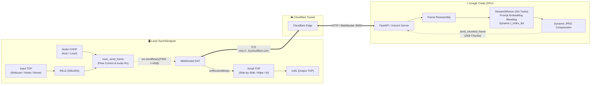

# ⚡ StreamDiffusion Remote TouchDesigner Bridge (`colab-sd`)

Real-time generative AI pipeline bridging **[StreamDiffusion](https://github.com/cumulo-autumn/StreamDiffusion)** (Stability AI SD-Turbo) running on a remote **Google Colab GPU** (T4 / L4 / A100) directly into local **TouchDesigner** via a secure, zero-config **Cloudflare Tunnel**.


-blue)

-yellow)
-success)

---

## 🌟 Key Features

* **Cloud GPU Powered:** Run SD-Turbo on Google Colab (Free or Pro tiers with NVIDIA T4, L4, or A100) with zero local GPU load.
* **Two Generation Modes:**
  * **Text-to-Image (`txt2img`):** High-speed continuous visual stream (15–30 FPS) driven by prompts, blend weights, and seeds.
  * **Image-to-Image / Video-to-Video (`img2img`):** Real-time interactive stylization driven by TouchDesigner TOPs (external generators like `Noise TOP`, live webcam feed, or movie files).
* **Dual-Prompt Latent Morphing:** Seamlessly crossfade between **Prompt A** and **Prompt B** using the **Prompt Blend** slider ($0.0 \dots 1.0$). Blends encoded CLIP latent text embeddings directly on the GPU in $< 1\text{ ms}$ without pipeline stalls.
* **Negative Prompt Support:** Guide generation clarity by filtering out unwanted artifacts, blur, and distortion.
* **Interactive Denoise Strength Slider:** Dynamically shift between preserving subtle original contours ($0.2$) and dramatic AI reinterpretation ($0.8+$) in real time.
* **Real-time Audio Reactivity & CHOP Hooks:**
  * Wire any CHOP into the **`in_audio`** input connector or specify an external CHOP path.
  * **Audio $\rightarrow$ Denoise Gain:** Dynamically modulates denoise depth with audio volume/amplitude.
  * **Beat Seed Randomizer:** Detects kick transients and triggers random seeds synchronized to the tempo.
* **Flexible Inspection Modes (Side-by-Side & Split Wipe):**
  * **AI Output Only:** Clean full-frame generative canvas.
  * **Side-by-Side:** Dual-pane inspection showing camera/noise input next to AI output with a yellow separator.
  * **Split Wipe (50/50):** Half-and-half split view for precise texture alignment.
  * **Input Only:** View the raw input stream.
* **1-Click High-Res Snapshot Recorder:** Exports pristine PNG frames to `captures/` along with complete JSON sidecar metadata (prompts, blend, seed, denoise strength, FPS, inference time, and GPU telemetry).
* **Remote Hardware Telemetry HUD:** Live monitoring of Colab GPU inference time (ms), GPU VRAM allocation, GPU temperature (°C), network round-trip ping (ms), and effective video FPS.
* **Adaptive "Ping-Pong" Flow Control:** TouchDesigner sends frames immediately upon receipt of previous output, eliminating all socket buffer backlogs and reducing glass-to-glass latency to the physical minimum.
* **Zero-Config Cloudflare Tunneling:** Encrypted `wss://` WebSockets over Cloudflare Edge (`trycloudflare.com`). No port forwarding, public IP, or VPN required.
* **Immune to OpenSSL TLS Record Limits:** Custom **bidirectional chunking protocol** ($\le 4096$ bytes per packet) prevents TouchDesigner `WebSocket DAT` buffer overflows and `ssl3_write_bytes:bad length` exceptions.
* **Standalone Drag-and-Drop Component (`.tox`):** Single self-contained `StreamDiffusion_Remote.tox` ready to drop into ANY TouchDesigner project.

---

## 🏗️ Architecture



---

## 🚀 Quick Start

### 1. Launch Server on Google Colab

1. Open [Google Colab](https://colab.research.google.com/) and upload `StreamDiffusion_Colab_Server.ipynb` (or open it from Google Drive).
2. Ensure GPU runtime is active:
   * **Runtime** $\rightarrow$ **Change runtime type** $\rightarrow$ **Hardware accelerator: GPU** (Select **T4**, **L4**, or **A100**).
3. Click **Runtime** $\rightarrow$ **Run all** (or execute cells 1 through 4 sequentially).
4. Cell 4 will download SD-Turbo weights (~2.5GB), warm up the pipeline, start the server, and print your unique WebSocket URL:
   ```text
   🚀 StreamDiffusion Server is READY & STREAMING!
   Copy this URL and paste it into TouchDesigner:
   wss://recorder-thunder-example.trycloudflare.com/ws/stream
   ```

---

### 2. Connect TouchDesigner

1. Open `colab-sd.toe` in TouchDesigner (or drag `StreamDiffusion_Remote.tox` into your project).
2. Select the **`StreamDiffusion_Remote`** component.
3. In the parameter dialog:
   * **Colab WebSocket URL:** Paste the `wss://.../ws/stream` address from Colab.
   * **Connect to Colab:** Toggle **On**.
   * **Generation Mode:** Choose `Text to Image` or `Image / Noise to Image`.
   * **Prompt A / Prompt B & Blend:** Set your creative prompts and blend between them with the slider.
4. Video streams directly to `null1` in real time with live telemetry!

---

## 🎛️ TouchDesigner Component Parameters

The `StreamDiffusion_Remote` COMP exposes all controls on the **StreamDiffusion** parameter page:

| Parameter | Type | Default | Description |
| :--- | :--- | :--- | :--- |
| **Colab WebSocket URL** | String | `wss://...` | Cloudflare `wss://` endpoint generated by Cell 4 in Colab. |
| **Connect to Colab** | Toggle | `Off` | Connects or disconnects the WebSocket stream. |
| **Generation Mode** | Menu | `Text-to-Video` | `txt2img` (continuous AI synthesis) or `img2img` (audio/visual stylization). |
| **Input Source** | Menu | `External Input` | `External Input (in1)` (wired cable), `Webcam (cam_in)`, or `Internal Noise`. |
| **Display Mode** | Menu | `AI Output Only` | `ai` (AI output), `sidebyside` (Input \| Output), `wipe` (50/50 split), `input` (raw input). |
| **Prompt A** | String | `cinematic cyberpunk...` | Primary text prompt steering diffusion synthesis. |
| **Prompt B** | String | `bioluminescent jungle...` | Secondary text prompt for latent morphing. |
| **Prompt Blend (A <-> B)** | Float (0.0–1.0) | `0.0` | Real-time GPU latent interpolation weight ($0.0 = A$, $1.0 = B$). |
| **Negative Prompt** | String | `blurry, low quality...` | Negative conditioning prompt to suppress artifacts. |
| **Submit Prompts** | Pulse | — | Manually forces prompt and parameter re-synchronization. |
| **Denoise Strength** | Float (0.1–1.0) | `0.6` | Controls input preservation vs. imaginative AI transformation in `img2img`. |
| **Seed** | Integer | `42` | Random generation seed. |
| **Randomize Seed** | Pulse | — | Rolls a new random seed and updates the model immediately. |
| **Take Snapshot** | Pulse | — | Captures the current AI frame as a PNG and writes a complete JSON sidecar. |
| **Snapshot Directory** | String | `captures` | Target folder for saved snapshots (relative to project folder or absolute). |
| **Audio Reactivity** | Toggle | `Off` | Enables real-time CHOP modulation and beat detection. |
| **Audio CHOP Source** | String | `in_audio` | Path or name of the CHOP to monitor if not wired to the `in_audio` connector. |
| **Audio -> Denoise Gain** | Float (0.0–1.0) | `0.3` | Dynamic denoise strength boost proportional to audio peak amplitude. |
| **Audio Beat Threshold** | Float (0.1–1.0) | `0.8` | Audio level threshold that triggers an automatic seed randomization on kick drum peaks. |
| **Status** | String (Display) | `Disconnected` | Live connection status and streaming FPS. |
| **Effective FPS** | String (Display) | `0.0 FPS` | Measured video delivery rate received from Colab. |
| **Colab Inference** | String (Display) | `-- ms` | Server-side GPU forward pass latency per frame. |
| **Network Ping (RTT)**| String (Display) | `-- ms` | Round-trip network transmission time over WebSocket. |
| **Colab GPU VRAM** | String (Display) | `--` | Remote GPU memory usage (e.g. `2.4/15.0GB (16%)`). |
| **Colab GPU Temp** | String (Display) | `--` | Remote GPU core temperature (e.g. `46°C`). |

---

## 🔬 Technical Deep-Dive

### 1. Real-Time Latent Embedding Interpolation
Instead of re-parsing text strings or re-initializing pipeline schedules, dual-prompt blending operates in CLIP text embedding space:
$$\mathbf{e}_{\text{blended}} = (1.0 - \alpha) \cdot \mathbf{e}_A + \alpha \cdot \mathbf{e}_B$$
* Both embeddings are pre-computed with `pipe.encode_prompt()` on the GPU.
* The blended embedding tensor is directly assigned to `stream.prompt_embeds`.
* Execution time is $< 1\text{ ms}$, enabling silky-smooth visual morphing with zero frame drops when sliding `Prompt Blend`.

### 2. Adaptive "Ping-Pong" Flow Control
Instead of flooding the network on a blind timer, TouchDesigner employs **reactive token flow control**:
* TouchDesigner transmits input frame $N$ and sets `can_send = False`.
* Google Colab receives frame $N$, processes through StreamDiffusion ($\sim 75\text{ ms}$), and streams back the output frame.
* TouchDesigner finishes reassembling frame $N$, displays it on the GPU texture, and immediately resets `can_send = True`.
* On the next frame start, TouchDesigner samples the freshest camera/noise input and transmits frame $N+1$.
* A $250\text{ ms}$ watchdog timer automatically recovers streaming if a packet is ever dropped on the internet.
* A $30\text{ FPS}$ ceiling ($\ge 33\text{ ms}$ spacing) ensures bandwidth efficiency.

### 3. Dynamic Timestep Scheduling (`t_index_list`)
StreamDiffusion uses sparse timesteps for real-time inference:
* **`txt2img`:** `t_index_list=[0, 16, 32, 45]` (4 denoising steps). Produces sharp, coherent images that closely track prompt changes without visual mosaic artifacts.
* **`img2img`:** SD-Turbo has 50 timesteps. The server maps TouchDesigner's `Strength` slider dynamically:
  $$t_0 = \max\left(5, \min\left(44, \text{int}(45 - \text{strength} \times 40)\right)\right), \quad t\_\text{index\_list} = [t_0, 45]$$
  * `Strength = 0.2` $\rightarrow [37, 45]$ (Subtle styling, original composition 90% preserved).
  * `Strength = 0.6` $\rightarrow [21, 45]$ (Balanced hybrid of input contours and prompt generation).
  * `Strength = 0.9` $\rightarrow [9, 45]$ (Heavy AI re-imagination).
  Because the schedule length ($2$ steps) remains constant, update latency is $\le 2\text{ ms}$ with zero GPU memory reallocation!

### 4. Bidirectional Binary Chunking Protocol
TouchDesigner's `WebSocket DAT` relies on POCO C++ and OpenSSL. When transmitting payloads larger than 16 KB over TLS (`wss://`), OpenSSL triggers `SSL_R_BAD_LENGTH` (`1409E10F:ssl3_write_bytes:bad length`) or POCO `Payload too big`.

To solve this, a custom chunking protocol operates in both directions:
* **TouchDesigner $\rightarrow$ Colab (Input Frames):** Sliced into chunks $\le 4096\text{ bytes}$ with a 7-byte binary header:
  $$\text{b'FRM:'} \; (4\text{ bytes}) + \text{frame\_id} \; (1\text{ byte}) + \text{chunk\_idx} \; (1\text{ byte}) + \text{total\_chunks} \; (1\text{ byte})$$
* **Colab $\rightarrow$ TouchDesigner (Output Stream):** Output frames ($512\times 512$) are sliced into 2048-byte chunks with a 3-byte header:
  $$\text{frame\_counter} \; (1\text{ byte}) + \text{chunk\_idx} \; (1\text{ byte}) + \text{total\_chunks} \; (1\text{ byte})$$

---

## 🛠️ Automated Sync to GitHub

Whenever you want to backup your project:
* On Windows, double-click **`sync.bat`**.
* Or from PowerShell/Terminal, run:
  ```powershell
  python sync_to_github.py "Your commit message"
  ```
The script automatically rebuilds `.toe` and `.tox`, updates the notebook, stages all files, and synchronizes to your private GitHub repo (`wenjunii/colab-sd`). If branch protection is enabled on `main`, the script automatically creates and merges a pull request with admin credentials so syncing is completely frictionless.

---

## 📄 License

This bridge is provided as an open tool for the TouchDesigner and creative coding community. Built with [StreamDiffusion](https://github.com/cumulo-autumn/StreamDiffusion) and [TouchDesigner](https://derivative.ca/).
