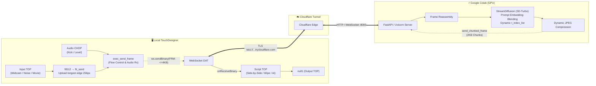

# ⚡ StreamDiffusion Remote TouchDesigner Bridge (`colab-sd`)

Real-time generative AI pipeline bridging **[StreamDiffusion](https://github.com/cumulo-autumn/StreamDiffusion)** (Stability AI SD-Turbo) running on a remote **Google Colab GPU** (T4 / L4 / A100) directly into local **TouchDesigner** via a secure, zero-config **Cloudflare Tunnel**.


-blue)

-yellow)


---

## 🌟 Key Features

* **Cloud GPU Powered:** Run diffusion on a Google Colab GPU. TouchDesigner uses the local GPU for its TOP network and display.
* **Two Generation Modes:**
  * **Text-to-Image (`txt2img`):** Continuous visual stream driven by prompts, blend weights, and seeds, using a single-image SD-Turbo batch.
  * **Image-to-Image / Video-to-Video (`img2img`):** Real-time interactive stylization driven by TouchDesigner TOPs (external generators like `Noise TOP`, live webcam feed, or movie files).
* **Output Resolution / Ratio:** Select from 16 square, landscape, and portrait presets, up to **1024 × 768** or **768 × 1024**. **512 × 512** remains the default. This changes actual Colab generation dimensions, rather than resizing the received image.
* **Dual-Prompt Latent Morphing:** Crossfade between **Prompt A** and **Prompt B** using **Prompt Blend** ($0.0 \dots 1.0$). A bounded embedding cache avoids re-running CLIP for blend, seed, and repeated control updates. Strength schedule changes still require preparation.
* **Negative Prompt Control:** Retained for compatibility and snapshot metadata. SD-Turbo runs without classifier-free guidance and does not apply negative conditioning; see the [model card](https://huggingface.co/stabilityai/sd-turbo).
* **Interactive Denoise Strength Slider:** Dynamically shift between preserving subtle original contours ($0.2$) and dramatic AI reinterpretation ($0.8+$) in real time.
* **Real-time Audio Reactivity & CHOP Hooks:**
  * Wire any CHOP into the **`in_audio`** input connector or specify an external CHOP path.
  * **Audio $\rightarrow$ Denoise Gain:** Dynamically modulates denoise depth with audio volume/amplitude.
  * **Beat Seed Randomizer:** Detects kick transients and triggers random seeds synchronized to the tempo.
* **Flexible Inspection Modes (Side-by-Side & Split Wipe):**
  * **AI Output Only:** Clean full-frame generative canvas.
  * **Side-by-Side:** Dual-pane inspection showing camera/noise input next to AI output with a yellow separator.
  * **Split Wipe (50/50):** Half-and-half split view for precise texture alignment.
  * **Input Only:** Preview the input even before connecting to Colab.
* **Snapshot Recorder:** Saves received frames as PNG in `captures/`, with JSON metadata for current controls, actual dimensions, engine, and telemetry. Received frames have already undergone JPEG compression; converting them to PNG does not recover lost detail. Filenames include microseconds to avoid overwriting rapid captures.
* **Remote Hardware Telemetry HUD:** Live monitoring of Colab GPU inference time (ms), GPU VRAM allocation, GPU temperature (°C), network round-trip ping (ms), and effective video FPS.
* **Adaptive "Ping-Pong" Flow Control:** TouchDesigner sends the next input after receiving an output, with bounded newest-frame queues to reduce stale-frame buildup.
* **Zero-Config Cloudflare Tunneling:** Encrypted `wss://` WebSockets over Cloudflare Edge (`trycloudflare.com`). No port forwarding, public IP, or VPN required.
* **Small TLS Packets:** Bidirectional chunking uses input payloads up to 4096 bytes and output payloads up to 2048 bytes, plus their headers, to avoid the previously observed large-packet errors.
* **Recovery and Diagnostics:** Invalid controls are rejected before changing model state. Failed resolution changes attempt to restore the previous configuration. `/health` exposes readiness, dimensions, active engine, and the latest configuration error. One active TouchDesigner controller is accepted per server.
* **Standalone Drag-and-Drop Component (`.tox`):** Single self-contained `StreamDiffusion_Remote.tox` ready to drop into ANY TouchDesigner project.

---

## 🏗️ Architecture



---

## 🚀 Quick Start

### 1. Launch Server on Google Colab

1. Open [Google Colab](https://colab.research.google.com/) and upload `StreamDiffusion_Colab_Server.ipynb` (or open it from Google Drive / clone this repo).
2. Ensure GPU runtime is active:
   * **Runtime** $\rightarrow$ **Change runtime type** $\rightarrow$ **Hardware accelerator: GPU** (Select **T4**, **L4**, or **A100**).
3. Execute cells 1 through 3.
4. In **Cell 4 (Launch Server)**, configure the **1-Toggle Acceleration Switch**:
   * **`ENABLE_TENSORRT = False` (Default):** PyTorch Native FP16 without engine compilation.
   * **`ENABLE_TENSORRT = True`:** Installs a Torch-TensorRT release matching the existing PyTorch build, then compiles and validates the UNet for both modes. Requires Python 3.11+ and PyTorch 2.11+. Compilation can take several minutes at startup and after an output-size change. TinyVAE stays in PyTorch. Actual FPS and latency depend on GPU, resolution, and connection.
5. Run Cell 4. The server downloads SD-Turbo weights (~2.5GB), completes GPU warmup, and displays your live WebSocket endpoint:
   ```text
   StreamDiffusion is ready
   Paste this URL into TouchDesigner:
   wss://recorder-thunder-example.trycloudflare.com/ws/stream
   ```
6. Re-running the launch cell stops its own earlier server and tunnel. Interrupting the cell stops both. Startup and tunnel discovery have timeouts; logs remain in `bridge_logs/server.log` and `bridge_logs/tunnel.log`. TensorRT installation logs are in `bridge_logs/tensorrt-setup.log`. An unrelated process on port 8000 is reported rather than killed. If requested TensorRT setup or compilation fails, startup stops rather than announcing a PyTorch fallback as ready. Uncheck TensorRT to explicitly use native mode.

Setup checks out [StreamDiffusion revision `b623251`](https://github.com/cumulo-autumn/StreamDiffusion/commit/b623251dc055e1fd858d53509aa43e09dfc5cdc0) and installs core dependencies together using the compatibility pins in `colab_setup.py`. The notebook bundles the server, shared protocol, and launcher sources; no manual helper uploads are required.

---

### 2. Connect TouchDesigner

1. Open `colab-sd.toe` in TouchDesigner (or drag `StreamDiffusion_Remote.tox` into your project).
2. Select the **`StreamDiffusion_Remote`** component.
3. In the parameter dialog:
   * **Colab WebSocket URL:** Paste the `wss://.../ws/stream` address from Colab.
   * **Connect to Colab:** Toggle **On**.
   * **Generation Mode:** Choose `Text to Image` or `Image / Noise to Image`.
   * **Prompt A / Prompt B & Blend:** Set your creative prompts and blend between them with the slider.
4. Video streams directly to `null1` in real time with live telemetry!
5. Choose **Output Resolution / Ratio** to trade detail for speed and select the canvas shape. Changing resolution pauses generation while model buffers reload. TensorRT rebuilds both engines for the new dimensions, which can take several minutes. 512 × 512 is the model's preferred size. Larger output uses more GPU memory and bandwidth and may reduce FPS.

| Aspect ratio | Output presets |
| :--- | :--- |
| 1:1 Square | 256 × 256, 384 × 384, **512 × 512 (default)**, 768 × 768 |
| 4:3 Landscape | 512 × 384, 768 × 576, **1024 × 768** |
| 3:4 Portrait | 384 × 512, 576 × 768, **768 × 1024** |
| 16:9 Widescreen | 512 × 288, 768 × 432, 1024 × 576 |
| 9:16 Vertical | 288 × 512, 432 × 768, 576 × 1024 |

Maximum generated area is 786,432 pixels (1024 × 768); square output stops at 768 × 768. The input is uniformly scaled and center-cropped to the selected ratio using [Fit Outside](https://derivative.ca/UserGuide/Fit_TOP). Uploads retain that ratio with their longest edge at 256px.

### Updating an existing installation

Update both sides together: use the current Colab notebook and reload `colab-sd.toe` or replace the component with the current `StreamDiffusion_Remote.tox`. In Colab, run the setup and write-server cells before restarting the launch cell. Copy the new tunnel URL into TouchDesigner; old `trycloudflare.com` URLs can expire. A version mismatch is reported in Status.

For a first connection, keep 512 × 512 or choose a smaller output. After frames arrive, compare Effective FPS, Network Ping, and Frame Round Trip before increasing resolution or enabling TensorRT. CPU tests check behavior; they do not establish GPU image quality or live latency.

---

## 🎛️ TouchDesigner Component Parameters

The `StreamDiffusion_Remote` COMP exposes all controls on the **StreamDiffusion** parameter page:

| Parameter | Type | Default | Description |
| :--- | :--- | :--- | :--- |
| **Colab WebSocket URL** | String | `wss://...` | Cloudflare `wss://` endpoint generated by Cell 4 in Colab. |
| **Connect to Colab** | Toggle | `Off` | Connects or disconnects the WebSocket stream. |
| **Generation Mode** | Menu | `Text-to-Video` | `txt2img` (continuous AI synthesis) or `img2img` (audio/visual stylization). |
| **Output Resolution / Ratio** | Menu | `512 × 512` | 16 presets for 1:1, 4:3, 3:4, 16:9, and 9:16, up to 1024 × 768 or 768 × 1024. Changing size reloads the Colab pipeline. |
| **Input Source** | Menu | `External Input` | `External Input (in1)` (wired cable), `Webcam (cam_in)`, or `Internal Noise`. |
| **Display Mode** | Menu | `AI Output Only` | `ai` (AI output), `sidebyside` (Input \| Output), `wipe` (50/50 split), `input` (raw input). |
| **Prompt A** | String | `cinematic cyberpunk...` | Primary text prompt steering diffusion synthesis. |
| **Prompt B** | String | `bioluminescent jungle...` | Secondary text prompt for latent morphing. |
| **Prompt Blend (A <-> B)** | Float (0.0–1.0) | `0.0` | Real-time GPU latent interpolation weight ($0.0 = A$, $1.0 = B$). |
| **Negative Prompt** | String | `blurry, low quality...` | Stored control value; SD-Turbo with CFG disabled does not apply negative conditioning. |
| **Submit Prompts** | Pulse | — | Manually forces prompt and parameter re-synchronization. |
| **Denoise Strength** | Float (0.1–1.0) | `0.6` | Controls input preservation vs. imaginative AI transformation in `img2img`. |
| **Seed** | Integer | `42` | Random generation seed. |
| **Randomize Seed** | Pulse | — | Rolls a new random seed and updates the model immediately. |
| **Take Snapshot** | Pulse | — | Captures the current AI frame as a PNG and writes a complete JSON sidecar. |
| **Snapshot Directory** | String | `captures` | Target folder for saved snapshots (relative to project folder or absolute). |
| **Audio Reactivity** | Toggle | `Off` | Enables real-time CHOP modulation and beat detection. |
| **Audio CHOP Source** | String | `in_audio` | Path or name of the CHOP to monitor if not wired to the `in_audio` connector. |
| **Audio -> Denoise Gain** | Float (0.0–1.0) | `0.3` | Dynamic denoise strength boost proportional to audio peak amplitude. |
| **Audio Beat Threshold** | Float (0.1–1.0) | `0.8` | Audio level threshold that triggers an automatic seed randomization on kick drum peaks. |
| **Status** | String (Display) | `Disconnected` | Live connection status and streaming FPS. |
| **Acceleration Engine** | String (Display) | `--` | `PyTorch (FP16)` or `TensorRT (UNet)` for the current mode. TinyVAE remains in PyTorch. |
| **Effective FPS** | String (Display) | `0.0 FPS` | Measured video delivery rate received from Colab. |
| **Colab Inference** | String (Display) | `-- ms` | Server-side GPU forward pass latency per frame. |
| **Network Ping (RTT)**| String (Display) | `-- ms` | Application ping/pong time, measured every two seconds, separate from frame generation. |
| **Server Frame Processing** | String (Display) | `-- ms` | Input JPEG decode, inference, output conversion, and JPEG encoding; excludes worker queue and network time. |
| **Frame Round Trip** | String (Display) | `-- ms` | Approximate input-send-to-result time in img2img, including server work and network transport. Not camera-to-screen latency; watchdog retries can affect this estimate. |
| **Colab GPU VRAM** | String (Display) | `--` | Remote GPU memory usage (e.g. `2.4/15.0GB (16%)`). |
| **Colab GPU Temp** | String (Display) | `--` | Remote GPU core temperature (e.g. `46°C`). |

---

## 🔬 Technical Deep-Dive

### 1. Real-Time Latent Embedding Interpolation
Instead of re-parsing text strings or re-initializing pipeline schedules, dual-prompt blending operates in CLIP text embedding space:
$$\mathbf{e}_{\text{blended}} = (1.0 - \alpha) \cdot \mathbf{e}_A + \alpha \cdot \mathbf{e}_B$$
* Embeddings are computed with `pipe.encode_prompt()` and cached by prompt, negative prompt, and pipeline identity. The cache holds at most four entries and clears when the pipeline reloads.
* The blended embedding tensor is directly assigned to `stream.prompt_embeds`.
* Unchanged controls skip embedding work. Blend changes interpolate cached embeddings; changing text or preparing a new strength schedule can still incur encoding work.

### 2. Adaptive "Ping-Pong" Flow Control
Instead of flooding the network on a blind timer, TouchDesigner employs **reactive token flow control**:
* TouchDesigner transmits input frame $N$ and sets `can_send = False`.
* Google Colab receives frame $N$, processes it through StreamDiffusion, and streams back the output frame.
* TouchDesigner finishes reassembling frame $N$, displays it on the GPU texture, and immediately resets `can_send = True`.
* On the next frame start, TouchDesigner samples the freshest camera/noise input and transmits frame $N+1$.
* A $250\text{ ms}$ watchdog timer automatically recovers streaming if a packet is ever dropped on the internet.
* Uploads are paced by responses and TouchDesigner's timeline, without the old fixed 33ms throttle. The upload branch downsamples on the GPU before texture readback, keeping the output ratio with its longest edge at 256px. The comparison input matches the selected output dimensions.
* Colab receives while inference runs, retaining only the newest waiting input frame. Rapid control updates similarly merge into the latest values while the model worker is busy.
* All model operations share one worker to prevent concurrent mutation of the shared pipelines. JPEG processing and cached GPU telemetry run off the WebSocket event loop; telemetry sampling does not pause frame generation.
* Text generation has a configurable ceiling of 60 FPS (`MAX_STREAM_FPS` environment variable, range 1–120), replacing the old 25 FPS ceiling. This is a pacing limit, not a promised delivery rate.

### 3. Dynamic Timestep Scheduling (`t_index_list`)
StreamDiffusion uses sparse timesteps for real-time inference:
* **`txt2img`:** `t_index_list=[0]`, one SD-Turbo image per call. In the upstream SD-Turbo wrapper, the previous `[0, 16, 32, 45]` setting created four independent one-step images and returned only the first; it did not perform four sequential refinement steps. See [the wrapper](https://github.com/cumulo-autumn/StreamDiffusion/blob/main/utils/wrapper.py) and [SD-Turbo inference](https://github.com/cumulo-autumn/StreamDiffusion/blob/main/src/streamdiffusion/pipeline.py).
* **`img2img`:** SD-Turbo has 50 timesteps. The server maps TouchDesigner's `Strength` slider dynamically:
  $$t_0 = \max\left(5, \min\left(44, \text{int}(45 - \text{strength} \times 40)\right)\right), \quad t\_\text{index\_list} = [t_0, 45]$$
  * `Strength = 0.2` $\rightarrow [37, 45]$ (Lower-noise styling that favors the input composition).
  * `Strength = 0.6` $\rightarrow [21, 45]$ (Balanced hybrid of input contours and prompt generation).
  * `Strength = 0.9` $\rightarrow [9, 45]$ (Heavy AI re-imagination).
  The schedule length remains two. Changing its first timestep calls `prepare()`, which rebuilds scheduling state and buffers. The cached blended prompt is restored afterward.

### 4. Bidirectional Binary Chunking Protocol
TouchDesigner's `WebSocket DAT` relies on POCO C++ and OpenSSL. When transmitting payloads larger than 16 KB over TLS (`wss://`), OpenSSL triggers `SSL_R_BAD_LENGTH` (`1409E10F:ssl3_write_bytes:bad length`) or POCO `Payload too big`.

To solve this, a custom chunking protocol operates in both directions:
* **TouchDesigner $\rightarrow$ Colab (Input Frames):** Sliced into chunks $\le 4096\text{ bytes}$ with a 7-byte binary header:
  $$\text{b'FRM:'} \; (4\text{ bytes}) + \text{frame\_id} \; (1\text{ byte}) + \text{chunk\_idx} \; (1\text{ byte}) + \text{total\_chunks} \; (1\text{ byte})$$
* **Colab $\rightarrow$ TouchDesigner (Output Stream):** JPEG frames at the selected output size are sliced into 2048-byte chunks with a 3-byte header:
  $$\text{frame\_counter} \; (1\text{ byte}) + \text{chunk\_idx} \; (1\text{ byte}) + \text{total\_chunks} \; (1\text{ byte})$$

Output JPEG quality adapts without changing the selected dimensions. The frame byte budget is 48KB for outputs up to 512 × 512 pixels and scales with pixel count for larger output, reaching 144KB at 1024 × 768. Every WebSocket packet remains at most 2048 payload bytes plus its three-byte header. WebSocket per-message deflate is disabled because the images are already JPEG-compressed. TouchDesigner displays the latest received frame once per timeline frame and caches its decoded pixels for repeated cooks. Snapshot metadata records the actual frame width and height.

---

## 💡 Tips & Troubleshooting

* **Reloading the Component in TouchDesigner:** If you make changes or pull an update while TouchDesigner is running, select **File $\rightarrow$ Revert to Saved**, or drag and drop `StreamDiffusion_Remote.tox` into your project. TouchDesigner does not reload `.toe` files from disk automatically while open.
* **Checking Engine Status:** Both modes use `TensorRT (UNet)` only after their separately compiled UNets pass output validation. Text generation uses batch one and the two-timestep image stream uses batch two. TinyVAE remains in PyTorch. Builder timing caches are separated by dimensions, batch size, GPU capability, and software versions. Engine reuse is disabled: a real TensorRT 10.15 cache/refit test returned NaNs, which output validation caught before readiness. Each startup or resolution change rebuilds immutable engines. Replacing the Colab runtime also discards its builder timing cache.
* **Old TensorRT Fallback:** `No module named 'polygraphy'` with CUDA 13 indicates the old StreamDiffusion installer path: it only handles CUDA 11/12 and can return without installing anything. The updated notebook uses [Torch-TensorRT](https://docs.pytorch.org/TensorRT/getting_started/installation.html), preserves the installed PyTorch/CUDA build, and verifies the actual backend before creating a tunnel. Update the notebook and rerun its write-server and launch cells; installing Polygraphy alone does not modernize the old compiler.
* **Measuring Improvements:** Compare Effective FPS, Server Frame Processing, Frame Round Trip, and Network Ping at the same output size and GPU type. The single-image batch reduces wasted text-generation work; live FPS and end-to-end latency still need measurement on your Colab connection. Start at 384 or 512, then try 256 for speed.
* **Connection Status:** Uploads pause until the socket is connected and the server confirms the requested mode and output size. The FPS readout falls to zero if no frames arrive. HTTP(S) tunnel addresses pasted into the URL control normalize to WS(S) and receive `/ws/stream` when no path was supplied.
* **Matching Versions:** Update the Colab notebook and TouchDesigner component together. A mismatched handshake displays a version message instead of leaving uploads silently paused.
* **Recovery:** The 250ms upload watchdog can retry an input after a missing response. Incomplete input frames expire after one second and have a 512KB reassembly limit. If configuration recovery also fails, readiness becomes false and a failure status is shown. Internal exception details stay in the Colab logs. Use Submit Prompts to retry, choose a smaller size, or restart the Colab launch cell.
* **Audio Reactivity:** Wire a CHOP into `in_audio` or specify its path, such as `/project1/audio_analysis`. Threshold crossings trigger seeds with hysteresis and a cooldown, so sustained loud audio does not repeatedly randomize them. Text mode reacts through seeds; denoise modulation is sent only for img2img.

---

## Development checks

In an isolated Python 3.10 environment, install `requirements-test.txt`, then run `python -m unittest discover -s tests -v`. The model stand-ins need no GPU or downloaded weights. For CPU-only PyTorch, install `torch==2.5.1` from `https://download.pytorch.org/whl/cpu` before installing the requirements. These checks cover streaming, controls, recovery, frame limits, TouchDesigner callbacks, native build failure handling, notebook consistency, launcher ownership, and sync failures. Live Colab performance and image quality still require a GPU integration run.

GPU integration verified on 2026-10-31 at 512 × 512 with an A100, Python 3.13.16, PyTorch 2.11.0+cu130, Torch-TensorRT 2.11.0, and TensorRT 10.15.1.29. Both UNets compiled completely into TensorRT and passed numerical comparison against native output. WebSocket checks decoded non-flat JPEG frames in both modes, changed image denoise strength from 0.2 to 0.9, blended prompts, and switched back to text generation. Larger profiles and other GPU types need their own integration checks. The compiler exports standard attention operations and uses the validated FP16 builder configuration to avoid FlashAttention conversion and strong-typing compiler failures.

Windows setup:

```powershell
python -m venv .venv
.\.venv\Scripts\python.exe -m pip install torch==2.5.1 --index-url https://download.pytorch.org/whl/cpu
.\.venv\Scripts\python.exe -m pip install -r requirements-test.txt
.\.venv\Scripts\python.exe -m unittest discover -s tests -v
```

`python generate_notebook.py --check` detects a stale notebook. GitHub Actions runs the CPU suite and this source consistency check on pushes and pull requests; native TouchDesigner archive builds are verified locally on Windows.

Run `python build_clean_toe.py` from any folder. It locates TouchDesigner automatically, or accepts `--td-bin "C:\Program Files\Derivative\TouchDesigner\bin"` (also configurable with `TOUCHDESIGNER_BIN`). Both archives build in a temporary staging folder before replacing the previous outputs. The standalone archive includes its root custom parameter files.

| Source | Responsibility |
| :--- | :--- |
| `bridge_protocol.py` | Shared output presets, control validation, and input frame assembly |
| `colab_server.py` | Model loading, recovery, generation, health, and WebSocket streaming |
| `colab_setup.py` / `colab_launcher.py` | Colab environment setup and owned server/tunnel lifecycle |
| `tensorrt_backend.py` | Matching TensorRT dependencies, compilation, output validation, and per-mode builder timing caches |
| `build_clean_toe.py` | TouchDesigner parameters, embedded callbacks, and native archive packaging |
| `generate_notebook.py` | Self-contained notebook generation and freshness checking |

## 🛠️ Automated Sync to GitHub

Whenever you want to backup your project:
* On Windows, double-click **`sync.bat`**.
* Or from PowerShell/Terminal, run:
  ```powershell
  python sync_to_github.py "Your commit message"
  ```
The script rebuilds both archives, regenerates the notebook, runs tests and consistency checks, then stages, commits, and pushes the current branch. Any failed check stops the workflow. A clean working tree still retries an earlier unpushed commit. If `main` rejects a push because it is protected, the script creates a `codex/sync-*` branch and pull request. Other push failures stop without creating extra branches.

Use `python sync_to_github.py --check` for build and validation without Git changes, or `--dry-run` to describe the workflow without running commands. Protected-branch pull requests remain open by default. `--merge` explicitly requests merging; `--admin` additionally requests a protection bypass and requires `--merge`. Merge failures are reported and preserve the branch and PR for follow-up.

Supply `--pr-body-file path/to/description.txt` to publish a detailed UTF-8 PR description with its line breaks preserved. The sync log prints the test summary, and `sync.bat` preserves the Python script's exit code. After creating a protected-branch PR, wait for **Project checks** before merging it.

---

## 📄 License

This project is licensed under the [MIT License](LICENSE). Built with [StreamDiffusion](https://github.com/cumulo-autumn/StreamDiffusion) and [TouchDesigner](https://derivative.ca/) for the creative coding and real-time generative art community.
