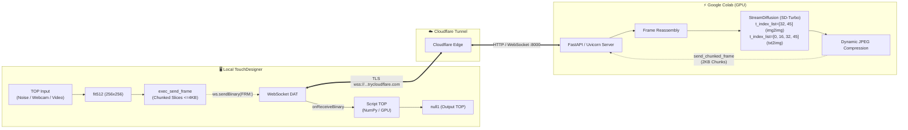

# ⚡ StreamDiffusion Remote TouchDesigner Bridge (`colab-sd`)

Real-time generative AI pipeline bridging **[StreamDiffusion](https://github.com/cumulo-autumn/StreamDiffusion)** (Stability AI SD-Turbo) running on a remote **Google Colab GPU** (T4 / L4 / A100) directly into local **TouchDesigner** via a secure, zero-config **Cloudflare Tunnel**.


-blue)

-yellow)

---

## 🌟 Key Features

* **Cloud GPU Powered:** Run SD-Turbo on Colab Pro / Free tier (NVIDIA T4, L4, or A100) with zero local GPU load.
* **Two Operating Modes:**
  * **Text-to-Image (`txt2img`):** Continuous real-time synthesis (20–30 FPS on Colab GPU) dynamically driven by prompt and seed updates.
  * **Image-to-Image / Video-to-Video (`img2img`):** Real-time interactive stylization driven by TouchDesigner TOPs (external generators like `Noise TOP`, live webcam feed, or internal noise).
* **Zero-Config Networking:** Uses Cloudflare Tunnels (`trycloudflare.com`) over secure WebSockets (`wss://`). No port forwarding, public IP, or VPN required.
* **Immune to OpenSSL / Buffer Limits:** Built-in **bidirectional chunking protocol** ($\le 4096$ bytes per packet) completely prevents TouchDesigner `WebSocket DAT` buffer overflows and `ssl3_write_bytes:bad length` exceptions.
* **Native TouchDesigner Integration:** Custom UI parameter page for instant prompt adjustments, seed randomization, source switching, and connection monitoring.

---

## 🏗️ Architecture



---

## 🚀 Quick Start

### 1. Launch Server on Google Colab

1. Open [Google Colab](https://colab.research.google.com/) and upload `StreamDiffusion_Colab_Server.ipynb`.
2. Ensure hardware acceleration is set to GPU:
   * **Runtime** $\rightarrow$ **Change runtime type** $\rightarrow$ **Hardware accelerator: GPU** (Select **T4**, **L4**, or **A100**).
3. Click **Runtime** $\rightarrow$ **Run all** (or execute cells 1 through 4 sequentially).
4. Cell 4 will download weights (~2.5GB), warm up the pipeline, start the server, and print your unique WebSocket URL:
   ```text
   🚀 StreamDiffusion Server is READY & STREAMING!
   Copy this URL and paste it into TouchDesigner:
   wss://recorder-thunder-example.trycloudflare.com/ws/stream
   ```

---

### 2. Connect TouchDesigner

1. Open `colab-sd.toe` in TouchDesigner.
2. Select the **`StreamDiffusion_Remote`** component.
3. In the parameter dialog:
   * **Colab WebSocket URL:** Paste the `wss://.../ws/stream` address from Colab.
   * **Generation Mode:** Choose `Text to Image` or `Image / Noise to Image`.
   * **Input Source:** Choose `External Input (in1)`, `Webcam`, or `Internal Noise`.
   * **Connect to Colab:** Toggle **On**.
4. The output will stream directly into `null1` in real time!

---

## 🎛️ TouchDesigner Component Parameters

The `StreamDiffusion_Remote` COMP exposes custom controls on the **StreamDiffusion** parameter page:

| Parameter | Type | Description |
| :--- | :--- | :--- |
| **Colab WebSocket URL** | String | The Cloudflare `wss://` endpoint generated by Cell 4 in Colab. |
| **Connect to Colab** | Toggle | Connects or disconnects the WebSocket stream. |
| **Generation Mode** | Menu | `Text to Image` (txt2img) or `Image / Noise to Image` (img2img/v2v). |
| **Input Source** | Menu | `External Input (in1)` (wired input), `Webcam (cam_in)`, or `Internal Noise`. |
| **Prompt** | String | Text prompt steering the visual generation in real time. |
| **Seed** | Integer | Random seed for generation consistency. |
| **Randomize Seed** | Pulse | Generates a new random seed and updates the model. |
| **Send Update** | Pulse | Manually forces prompt/parameter synchronization. |
| **Status** | String (Read-only) | Connection state (`Connected (Streaming)` or `Disconnected`). |

---

## 📂 Project Structure

```text
colab-sd/
├── colab-sd.toe                         # Main TouchDesigner project file
├── StreamDiffusion_Colab_Server.ipynb   # Complete 1-click Google Colab notebook
├── colab_server.py                      # FastAPI + Uvicorn server running StreamDiffusion
├── generate_notebook.py                 # Bundles colab_server.py into the .ipynb notebook
│
├── colab-sd.toe.dir/                    # Decompressed TouchDesigner component hierarchy
│   └── project1/
│       ├── null1.n                      # Output display TOP
│       ├── noise1.n                     # Example external input noise generator
│       └── StreamDiffusion_Remote/      # Main processing component
│           ├── in1.n                    # In TOP connector for external visual inputs
│           ├── switch_in.n              # Source selector switch
│           ├── null_cam.n               # Formatted input texture
│           ├── exec_send_frame.text     # Safe chunked 15 FPS frame uploader
│           ├── websocket1.parm          # WebSocket DAT network configuration
│           ├── websocket1_callbacks.text# Reassembly & control handler
│           └── script_receiver.text     # Script TOP NumPy buffer receiver
│
└── README.md                            # Documentation and architecture guide
```

---

## 🔬 Technical Deep-Dive

### 1. Bidirectional Binary Chunking Protocol
TouchDesigner's `WebSocket DAT` relies on POCO C++ and OpenSSL. When transmitting payloads larger than 16 KB over TLS (`wss://`), OpenSSL triggers `SSL_R_BAD_LENGTH` (`1409E10F:ssl3_write_bytes:bad length`) or POCO `Payload too big`.

To solve this, a custom chunking protocol operates in both directions:

* **TouchDesigner $\rightarrow$ Colab (Input Frames):**
  * Frames are downsampled to $256\times 256$ and JPEG-encoded ($\sim 5\text{ KB}$–$8\text{ KB}$).
  * Sliced into chunks $\le 4096\text{ bytes}$ with a 7-byte binary header:
    $$\text{b'FRM:'} \; (4\text{ bytes}) + \text{frame\_id} \; (1\text{ byte}) + \text{chunk\_idx} \; (1\text{ byte}) + \text{total\_chunks} \; (1\text{ byte})$$
  * Every packet is $\le 4103\text{ bytes}$, well under the 16 KB TLS record limit.

* **Colab $\rightarrow$ TouchDesigner (Output Stream):**
  * Output frames ($512\times 512$) are sliced into 2048-byte chunks with a 3-byte header:
    $$\text{frame\_counter} \; (1\text{ byte}) + \text{chunk\_idx} \; (1\text{ byte}) + \text{total\_chunks} \; (1\text{ byte})$$
  * Reassembled inside `websocket1_callbacks.text` and fed into `script_receiver` via NumPy copy.

### 2. Timestep Scheduling (`t_index_list`)
StreamDiffusion uses sparse timesteps for real-time inference:
* **`txt2img`:** `t_index_list=[0, 16, 32, 45]` (4 denoising steps). Produces sharp, coherent images that closely track prompt changes without visual mosaic artifacts.
* **`img2img`:** `t_index_list=[32, 45]` (2 denoising steps). Provides low-latency style transfer while retaining the spatial silhouette and motion of incoming inputs.

---

## 🛠️ Modifying the Server Code

If you make modifications to `colab_server.py`, regenerate the Colab notebook by running:

```powershell
python generate_notebook.py
```

Then push or re-upload `StreamDiffusion_Colab_Server.ipynb` to Google Colab.

---

## 📄 License

This bridge is provided as an open tool for the TouchDesigner and creative coding community. Built with [StreamDiffusion](https://github.com/cumulo-autumn/StreamDiffusion) and [TouchDesigner](https://derivative.ca/).
