# ⚡ StreamDiffusion Remote TouchDesigner Bridge (`colab-sd`)

Real-time generative AI pipeline bridging **[StreamDiffusion](https://github.com/cumulo-autumn/StreamDiffusion)** with **SD-Turbo** or experimental **SDXL-Turbo** on **Google Colab** or a **Windows/Linux NVIDIA RTX workstation** into local **TouchDesigner**. Optional backends add **Waypoint** image-seeded world video, **Krea Realtime** text-to-video and an **LTX-2.5 clip-generation trial**. Stream video over **WebRTC**, with **WebSocket JPEG / compact WebP fallback**. Connect over LAN/Tailscale/VPN or use a **Cloudflare Tunnel** for internet signaling and fallback.


-blue)

-yellow)


---

## 🌟 Key Features

* **Two Server Locations:** Choose **Google Colab** or **RTX Workstation (Windows / Linux)**. Each location remembers its own server URL. TouchDesigner uses the local GPU for its TOP network and display; the server runs diffusion.
* **WebRTC Video Output:** Native TouchDesigner WebRTC DAT / Video Stream In TOP, VP8 video, one pending server frame, and automatic WebSocket JPEG / WebP fallback. Shared by StreamDiffusion, Waypoint, Krea and LTX on either server location. No Scope code or separate local receiver application.
* **Compact WebSocket Output:** Optional 12 KB WebP target for constrained Colab/Tailscale links. Keeps full output resolution, checks TD decoder support and falls back to Fast JPEG when unsupported.
* **Google Drive Caching:** Enabled by default in all four Colab notebooks. Reuse model weights and compatible package downloads across runtimes; startup reports downloads, local reuse, staging and GPU loading separately.
* **Workstation Pairing:** A dedicated Python environment, CUDA preflight, configurable listening address/port, persistent access token, and optional Cloudflare tunnel. Text/image generation, prompts, audio, resolution, snapshots, and telemetry use the same protocol for either location.
* **Generation Modes:**
  * **Text-to-Image (`txt2img`):** Continuous visual stream driven by prompts, blend weights, and seeds, using a single-image SD-Turbo batch.
  * **SDXL-Turbo model option (experimental):** Startup selection for the same text/image modes, with dual text encoders, pooled prompt blending and matching SDXL TinyVAE. SD-Turbo remains the default.
  * **Image-to-Image / Video-to-Video (`img2img`):** Real-time interactive stylization driven by TouchDesigner TOPs (external generators like `Noise TOP`, live webcam feed, or movie files).
  * **World Model (`world`, optional Waypoint notebook):** Image-seeded, controller-driven video at native **1280 × 720**. Separate runtime and weights; no Scope dependency. See the setup below.
  * **Krea Realtime (`krea`, experimental Colab/workstation):** Prompt A drives temporal video at **832 × 480**, with Pause/Reset controls. Uses the Apache-declared HF modular release; basic A100 40 GB INT8 generation is verified, but measured generation is slower than real-time.
  * **LTX-2.5 (`ltx`, experimental):** Prompt A/Seed, image conditioning, steady slower playback with render-ahead, and configurable scene refresh on Colab or a high-VRAM workstation. A100 measurements are recorded below; workstation GPU performance needs its own validation. See its separate model-license conditions below.
* **Output Resolution / Ratio:** SD-Turbo supports 16 square, landscape, and portrait presets, up to **1024 × 768** or **768 × 1024**. **512 × 512** remains the default. Waypoint locks **1280 × 720 (Waypoint only)**; the Krea trial locks **832 × 480 (Krea only)**. This changes actual server generation dimensions, rather than resizing the received image.
* **Video Quality:** Compress network video independently of generation resolution. Fast targets 48 KB/frame, Balanced 64 KB, and Detail retains the larger resolution-based budget. Changing this control takes effect without a model or TensorRT rebuild.
* **Dual-Prompt Latent Morphing:** Crossfade between **Prompt A** and **Prompt B** using **Prompt Blend** ($0.0 \dots 1.0$). A bounded embedding cache avoids re-running CLIP for blend, seed, and repeated control updates. Strength schedule changes still require preparation.
* **Negative Prompt Control:** Retained for compatibility and snapshot metadata. SD-Turbo runs without classifier-free guidance and does not apply negative conditioning; see the [model card](https://huggingface.co/stabilityai/sd-turbo).
* **Interactive Denoise Strength Slider:** Dynamically shift between preserving subtle original contours ($0.2$) and dramatic AI reinterpretation ($0.8+$) in real time.
* **Real-time Audio Reactivity & CHOP Hooks:**
  * Wire any CHOP into the **`in_audio`** input connector or specify an external CHOP path.
  * **Audio $\rightarrow$ Denoise Gain:** Dynamically modulates denoise depth with audio volume/amplitude.
  * **Beat Seed Randomizer:** Detects kick transients and triggers random seeds synchronized to the tempo.
* **Flexible Inspection Modes (Side-by-Side & Split Wipe):**
  * **AI Output Only:** Clean full-frame generative canvas.
  * **Side-by-Side:** Dual-pane inspection showing camera/noise input next to AI output with a yellow separator.
  * **Split Wipe (50/50):** Half-and-half split view for precise texture alignment.
  * **Input Only:** Preview the input even before connecting to Colab.
* **Snapshot Recorder:** Saves received frames as PNG in `captures/`, with JSON metadata for current controls, actual dimensions, engine, and telemetry. Received frames have already undergone JPEG compression; converting them to PNG does not recover lost detail. Filenames include microseconds to avoid overwriting rapid captures.
* **Remote Hardware Telemetry HUD:** Live monitoring of server GPU inference time (ms), GPU VRAM allocation, GPU temperature (°C), network round-trip ping (ms), and effective video FPS.
* **Adaptive "Ping-Pong" Flow Control:** TouchDesigner sends the next input after receiving an output, with bounded newest-frame queues to reduce stale-frame buildup.
* **Zero-Config Cloudflare Tunneling:** Encrypted `wss://` WebSockets over Cloudflare Edge (`trycloudflare.com`). No port forwarding, public IP, or VPN required.
* **Small TLS Packets:** Bidirectional chunking uses input payloads up to 4096 bytes and output payloads up to 2048 bytes, plus their headers, to avoid the previously observed large-packet errors.
* **Recovery and Diagnostics:** Invalid controls are rejected before changing model state. Failed resolution changes attempt to restore the previous configuration. `/health` exposes readiness, dimensions, active engine, and the latest configuration error. One active TouchDesigner controller is accepted per server.
* **Standalone Drag-and-Drop Component (`.tox`):** Single self-contained `StreamDiffusion_Remote.tox` ready to drop into ANY TouchDesigner project.

---

## WebRTC video, relays and Tailscale

For a bandwidth-limited Tailscale/Colab connection, select **Video Transport → WebSocket images (JPEG / WebP)** on the **Streaming** page and **Video Quality → Compact WebP (12 KB target)** on the **StreamDiffusion** page. Start with **Video Buffer → 3 (balanced)**. Compact uses fast WebP encoding, keeps the selected generation/output resolution, and negotiates decoder support before sending WebP. An older server, missing WebP encoder, or unsupported TD decoder uses **Fast JPEG** instead. The default quality remains Balanced JPEG; the existing JPEG choices remain available. Quality changes do not reload models or rebuild TensorRT engines. WebRTC still uses VP8 and is unaffected by this setting.

In a **2026-11-06 Colab-to-Windows transport test**, the same synthetic 1024 × 768 image delivered **8.0 FPS** as approximately **12 KB WebP**, versus **2.32 FPS** as approximately **47 KB JPEG**, from an 8 FPS source. All 80 frames in each run decoded with the correct dimensions. The direct Tailscale route still had approximately **234 ms RTT**; compression reduces frame transmission/queuing time, not propagation delay. This is a CPU fixture/network result, not an A100 diffusion or live TouchDesigner FPS claim. [Recorded measurements](docs/benchmarks/Tailscale_Compact_1024x768_20261106.json).

Compact is lossy and can soften fine texture. Its byte target is best effort: highly detailed/noisy frames may exceed 12 KB at minimum quality, and the bridge preserves full resolution rather than silently shrinking them. The fast WebP method uses the existing Pillow/libwebp dependency; no model download or additional application is required. Real delivery FPS depends on content, encoding, model speed and the current network path.

All four Colab notebooks and Windows/Linux workstation backends share the same optional WebRTC output. Use the rebuilt `.toe` or `.tox`, then open its **Streaming** page and select **Video Transport → WebRTC (automatic fallback)**. Keep using the normal **Server WebSocket URL** and, for a workstation, its **Workstation Access Token**. **Active Video Transport** reports negotiation, receiving, or the fallback reason. Select **WebSocket images (JPEG / WebP)** to use image delivery explicitly. Switching video transport does not reload the diffusion model.

The authenticated WebSocket carries controls, telemetry and WebRTC signaling. It also continues carrying input images/world seeds; WebRTC currently replaces **server-to-TouchDesigner video output**. After WebRTC connects, the server passes full-resolution BGR frames directly to a VP8 encoder, bypassing per-frame JPEG/WebP compression. One pending video frame is retained; newer frames replace stale pending frames instead of accumulating a delivery queue. TouchDesigner receives through its native **WebRTC DAT / Video Stream In TOP**. **AI Output Only** uses the decoded TOP directly; comparison views use the existing display compositor. A failed or timed-out connection returns to bounded WebSocket image delivery. The last image is held while a model prepares the next frame/chunk.

**Cloudflare Tunnel carries signaling and JPEG/WebP image fallback, not WebRTC media.** WebRTC uses direct UDP where possible, or a separately configured TURN relay. STUN alone is the default and may fail through Colab/cloud NAT or restrictive home networks. No TURN account is included or created. No Hugging Face token is forwarded to a third-party TURN credential service.

For a relay, choose one of these configurations before starting the server:

* **Existing TURN credentials:** set `BRIDGE_ICE_SERVERS_JSON` to a JSON list such as `[{"urls":["turn:YOUR-RELAY:3478?transport=udp"],"username":"YOUR-USER","credential":"YOUR-PASSWORD"}]`. On Colab, save this as a **Secret** with the same name and enable Notebook access; the launch helper reads it without printing or embedding it in cell source. On a workstation, use that environment variable or `workstation.py start --backend BACKEND --ice-servers-file PATH`. Keep credential files outside Git; `webrtc-ice.local.json` is ignored. Static credentials must remain valid for the session.
* **Cloudflare Realtime TURN:** create a TURN key in your own Cloudflare account, then provide **`CLOUDFLARE_TURN_KEY_ID`** and **`CLOUDFLARE_TURN_API_TOKEN`** as Colab Secrets or server environment variables. The bridge requests 24-hour credentials from [Cloudflare's documented endpoint](https://developers.cloudflare.com/realtime/turn/generate-credentials/). Only temporary ICE credentials go to the authenticated TD client; the API token stays on the server. Explicit `BRIDGE_ICE_SERVERS_JSON` takes precedence. Reconnect to request fresh credentials; relay service limits/pricing and credential lifetime apply.

**Tailscale is an alternative private network path.** If both computers already have a working Tailscale interface, start a workstation with `--transport lan --bind SERVER-TAILSCALE-IP --advertise-host SERVER-TAILSCALE-IP`, then connect TD to `ws://SERVER-TAILSCALE-IP:8000/ws/stream` and enter the normal pairing token. Tailnet access rules/firewalls must permit the TCP signaling port and UDP WebRTC media between these devices. A reachable tailnet path can remove the need for TURN or a public Cloudflare tunnel. This project does not install Tailscale, sign devices into a tailnet, change routes, or alter existing VPN settings.

For **Colab**, a real Tailscale **TUN interface** can carry native WebRTC UDP if the runtime permits it: launch `BridgeSession` with `tunnel=False`, `host=SERVER-TAILSCALE-IP` and `advertise_host=SERVER-TAILSCALE-IP`. The runtime tested here had neither `/dev/net/tun` nor network-administration permission. Its validated alternative is an isolated **Tailscale 1.104.5 userspace daemon**, interactive device approval, and **private TCP Serve** (`tailscale serve --bg --tcp=8000 tcp://127.0.0.1:8000`). Launch the bridge with `tunnel=False`, `host='127.0.0.1'`, `advertise_host=SERVER-TAILSCALE-IP`, then use `ws://SERVER-TAILSCALE-IP:8000/ws/stream` and **WebSocket images** in TD. This private proxy carries control and image traffic, not native WebRTC UDP. Tailscale's [userspace networking mode](https://tailscale.com/docs/concepts/userspace-networking) does not transparently route aiortc media. No Funnel, exit node, subnet routes or DNS changes are required. An ephemeral `--state=mem:` identity must be approved again after the runtime is reset; its IP can change. Keep the normal Cloudflare route available when Tailscale is unavailable or slower.

Check `tailscale ping SERVER-TAILSCALE-IP` and `tailscale status`. A [**direct** connection](https://tailscale.com/docs/reference/connection-types) generally has better latency/throughput; **DERP relay** can still limit video performance. Tailscale does not guarantee a direct connection or a specific FPS.

**Upgrade:** rerun the matching notebook setup cell or `workstation.py setup --backend BACKEND` to add **aiortc 1.15.0 / PyAV 17.1.0**, then restart that bridge when ready. LTX retains Python 3.13 and its pinned CUDA/model stack; its PyAV pin is aligned with aiortc's supported `<18` range. Do not install these packages into TD or replace a running test session just to update the repository. New notebooks embed the transport helper automatically. Older servers/clients continue to use JPEG.

**Limits and licenses:** WebRTC changes delivery, not neural generation speed; LTX's initial/changed-prompt render waits remain. VP8 encoding runs on CPU (the A100 has no NVENC), so actual FPS depends on generation, CPU encoding and the network. **Video Quality / Video Buffer** controls apply to WebSocket JPEG/WebP delivery; WebRTC uses congestion control and a single pending frame. WebSocket image-delivery RTT/size readouts show unavailable/RTP while WebRTC is active rather than mislabeling stale JPEG measurements; decoded frames drive Effective FPS. The new transport uses [aiortc 1.15.0 (BSD-3-Clause)](https://github.com/aiortc/aiortc/blob/1.15.0/LICENSE) and [PyAV 17.1.0 (BSD-3-Clause)](https://github.com/PyAV-Org/PyAV/tree/v17.1.0), plus their codec/dependency licenses. No Scope application code is used. Model-weight terms remain separate and unchanged.

Validation includes a real CPU VP8 exchange at **1024 × 768**, color/orientation checks, prompt/control delivery, bounded replacement, credential redaction and fallback without model reload. A separate **TouchDesigner 2025.32820** native check decoded **411 frames**, displayed **11.7 FPS** from a synthetic 12 FPS source, and reported no recursive operator errors. [Recorded result](docs/benchmarks/WebRTC_TD_1024x768_CPU_20261106.json). This validates local transport, not diffusion inference, Colab internet/TURN performance or any promised FPS on the A100.

## SDXL-Turbo in StreamDiffusion (experimental)

The normal StreamDiffusion notebook and workstation runtime now offer **SDXL-Turbo** alongside the existing SD-Turbo default. Use the same `txt2img` / `img2img` modes, prompts/blend, denoise/audio controls, output presets, JPEG delivery, pairing and snapshots. Model choice is a **startup setting**. Waypoint has its own independent prompt-seed model selection below; Krea uses its separate backend.

**Colab:** in Step 4 of [the StreamDiffusion notebook](https://colab.research.google.com/github/wenjunii/colab-sd/blob/main/StreamDiffusion_Colab_Server.ipynb), set **DIFFUSION_MODEL = "sdxl-turbo"**. Start at **512 × 512**, which the [model card](https://huggingface.co/stabilityai/sdxl-turbo) recommends. Existing larger landscape/portrait presets remain available up to 1024 × 768 / 768 × 1024; SDXL-Turbo does not add a 1024 × 1024 preset. Keep the current test running until you are ready to launch the new script; opened notebook copies and loaded TD components do not update themselves.

**Workstation:** reuse the existing StreamDiffusion environment; a second CUDA environment is not needed:

```powershell
py -3.11 workstation.py start --model sdxl-turbo --advertise-host 192.168.1.50
```

On Linux replace `py -3.11` with `python3.11`. If this is a new workstation, run normal `workstation.py setup` first. Add `--tensorrt` to request TensorRT, or `--transport cloudflare` for the existing HTTP/2 tunnel. The **Server Model** readout in the updated TD component shows the model returned by the server; changing it requires restarting the server with a different startup selection. Selecting SDXL does not silently substitute SD-Turbo after a load/compile failure.

The pinned StreamDiffusion wrapper only constructs the SD pipeline. `sdxl_stream.py` explicitly loads [SDXL-Turbo revision `71153311d3dbb46851df1931d3ca6e939de83304`](https://huggingface.co/stabilityai/sdxl-turbo/tree/71153311d3dbb46851df1931d3ca6e939de83304) and [TAESDXL revision `b20258aaef75ef61e659c1e0f14f251cf0ad153e`](https://huggingface.co/madebyollin/taesdxl/tree/b20258aaef75ef61e659c1e0f14f251cf0ad153e), then uses the **same pinned StreamDiffusion core**. A small adapter supplies SDXL's pooled second-encoder text and six image-size/crop values to every UNet call. Prompt A/B blending and cached embedding restoration update both token and pooled embeddings, including after denoise-strength preparation. Both stream modes share model weights. No upstream source files are patched.

TensorRT exports **five live tensor inputs** for XL: latents, timesteps, token embeddings, pooled text and image-size conditioning. Batch-one text and batch-two image engines are compiled/validated separately, using the existing full-weight archive cache. Validation and cache reload checks vary prompt inputs; they must not freeze the initial prompt. Model weights/configuration fingerprints keep XL profiles separate from existing SD-Turbo archives. Drive/local model caches also retain the new pinned weights in their own Hub snapshot folders; active SD-Turbo models and caches are preserved.

**Validation:** the CPU suite covers XL condition expansion, cached token/pooled blending, startup/model identity, TD telemetry, and five-input compiler contracts. A separate disposable check executes the **real pinned StreamDiffusion core and Diffusers XL pipeline**, with two randomly initialized tiny CLIP encoders, a tiny random UNet and a toy VAE, for text-to-image and batched image-to-image operations. It downloads no pretrained model weights. **Full SDXL-Turbo GPU loading, image quality, peak VRAM, TensorRT build/reuse and sustained FPS remain unverified.** SDXL has larger weights and two encoders; SD-Turbo's measured speed/VRAM results do not predict its performance.

**Commercial use:** the application's StreamDiffusion code is Apache-2.0, but the [SDXL-Turbo model repository](https://huggingface.co/stabilityai/sdxl-turbo) lists a noncommercial community license and directs commercial use to [Stability AI's licensing terms](https://stability.ai/license). Those separate model terms apply to this optional selection; this project's MIT license does not grant unrestricted commercial rights to the weights. Use SDXL-Turbo commercially only under the applicable Stability AI license.

## LTX-2.5 on Colab A100 40 GB+ (experimental clips)

[Open the LTX-2.5 notebook in Colab](https://colab.research.google.com/github/wenjunii/colab-sd/blob/main/LTX25_Colab_Server.ipynb).

The A100 40 GB baseline successfully delivered 1024 × 576 / 33-frame clips to TouchDesigner: the initial clip took **361.52 seconds**, and a later clip took **235.86 seconds**. Logs showed repeated text-encoder and transformer loading dominated the delay; the two denoising loops took about 17 seconds. The optimized path caches one prompt's embeddings and reuses one quantized transformer allocation. On the same Colab A100 40 GB with existing local model files, the resident profile produced a 33-frame clip in **152.52 s** including prompt/weight loading, then automatically generated the next clip in **10.98 s (3.00 new FPS)** with scene continuation. Peak Torch-allocated memory was **24.15 GiB** for the initial clip and **19.87 GiB** for the cached clip. The prompt/seeds differ from the earlier cityscape baseline, so these observations are not a controlled same-prompt speedup benchmark. The [timing record](docs/benchmarks/LTX_A100_1024x576_resident_20261105.json) retains the exact revisions, seeds and limits. These November 5 measurements predate the steady-playback update: that version still had render-after-playback gaps. The current pipeline renders one clip ahead and paces playback to warm generation speed, as validated at 768 × 512 below. First-prompt loading and prompt changes still take time. Continuous generation advances seeds and can condition on the previous ending frame; it does not replay clips or claim 24 newly generated FPS. Generation speed and delivery FPS are reported separately.

CPU tests cover lifecycle, continuity, pause/off/disconnect handling, sticky failures, bounded queues, child environment isolation, ACK-gated delivery and TD controls. CI resolves dependencies and builds/imports the pinned LTX packages on Python 3.13/Linux and Windows with matching CPU binaries. `python -B check_ltx_imports.py` checks the pinned source hash, `ModelPaths`, pipeline/image/FP8/shared-weight API contracts, license separation and all five weight sizes/hashes without neural downloads. These checks do not establish full GPU performance or a complete GPU-dependency vulnerability audit.

**Commercial use and exact distributions:** application code comes from [Lightricks/LTX-2 revision `4f521619ae0029e8fbb64d555030c2b121a33b4f`](https://github.com/Lightricks/LTX-2/tree/4f521619ae0029e8fbb64d555030c2b121a33b4f), under Apache-2.0. The [LTX-2.5 model distribution at `49b093a39c19169a8a81721dcc541e07e945232f`](https://huggingface.co/Lightricks/LTX-2.5/tree/49b093a39c19169a8a81721dcc541e07e945232f) has separate [LTX-2.x Community License terms](https://github.com/Lightricks/LTX-2/blob/4f521619ae0029e8fbb64d555030c2b121a33b4f/LICENSE-2_x) (amended October 29, 2026). Eligible entities below **$10M annual revenue** can use the model commercially under those conditions; entities at or above **$10M**, aggregated with affiliates under common control, generally need a paid license for commercial use. Redistribution, derivatives and acceptable-use terms also apply. These are restricted model terms, not Apache-2.0 model weights. The bridge's MIT license does not replace them. Hugging Face model access must already be granted to the account supplying the read token.

1. Use an **A100 40 GB+**, with at least 35 GiB total / 30 GiB free VRAM for this trial. Stop any previous bridge's launch cell before setup. Setup refuses occupied port 8000 and does not stop other servers.
2. Add your Hugging Face **read token** to Colab **Secrets → HF_TOKEN**, with Notebook access enabled, for the first download or missing-file repair. Complete pinned cached weights can be reused without a token or Hub request. Keep credentials out of source, screenshots, logs and chat. The notebook reads the secret into the current process/owned child environment; it does not save the token in Drive or Git.
3. Run Step 2. It installs **`/content/colab-sd-ltx/venv`**, separate from other backends. The selected stack is **Torch 2.11.0 / torchvision 0.26.0 / torchaudio 2.11.0 with CUDA 13.0**, Transformers 5.14.1, **safetensors 0.8.0** (the Transformers minimum) and the two pinned LTX packages. The matched CUDA 13.0 wheels are selected explicitly rather than the upstream workspace's optional CUDA 13.2/NATTEN tooling. Other dependencies are pinned in `ltx_setup.py`; transitives are resolved within their requirements. Setup adds the isolated environment's `bin` directory to the child `PATH`, allowing `uv-build` to run without activating the environment or changing the notebook's parent `PATH`. CI resolves the dependency set on Python 3.13/Linux using explicit CPU Torch wheels without installing them, then builds both LTX wheels with the parent tools path removed and smoke-imports the pipeline using the matching CPU dependencies with Hub access disabled. These checks do not establish GPU installation/import compatibility. Setup names each stage and includes pip's error output in a failed-stage exception. After a failed install, rerun Step 2 from the updated notebook: matching installed packages and model caches are reused. No runtime reset or cache deletion is required for a corrected dependency pin or build-tool path.
4. Drive defaults On at **`MyDrive/StreamDiffusion/ltx25-models`**. The five selected checkpoints total **71.1 GB / 66.2 GiB**: distilled BF16 transformer, Gemma4 text encoder with projections/embedded sidecars, convolutional video VAE, audio VAE and spatial upscaler. Allow at least **72 GB in Drive + 72 GB on VM disk**, plus several GB in Drive for package downloads and VM space for installed packages. Without Drive, both weight copies occupy VM disk. Only these five files download; the dev transformer, heavier diffusion VAE, detailing LoRA and temporal upscaler are excluded.
5. Step 3 defaults to native **1024 × 576 (16:9)** generation, with **512 × 512**, **768 × 512**, and **1024 × 768** also available. Both dimensions must be multiples of 64 for the official two-stage pipeline; 768 × 432 and 512 × 288 are not compatible. Select **17 / 33 / 65 / 121 frames** (33 default). Use 512 × 512 for a smaller initial GPU test. The benchmark records below identify their tested presets and runtime revisions. Resolution is locked while running: stop Step 3, select another preset and rerun it. TouchDesigner adopts the startup size on connection. Leave **INPUT_IMAGE** empty for text-to-video; for image-to-video, upload an image using Colab Files and supply its absolute path before launching. This image is a startup selection.
6. Open the updated `.toe` / `.tox`, paste the printed URL and Connect. The handshake selects **LTX-2.5 (Clip Generation)** and the server size. Edit **Prompt A / Seed**, then pulse **LTX → Generate or Restart** once. **Continuous Generation** defaults On. It first prepares two clips, then renders one clip ahead while the preceding clip plays at a sustainable, slower rate. Seeds advance from the selected base seed, including wraparound. **Continue Scene from Last Frame** defaults On; each next clip uses the previous final frame as image conditioning. Turn it Off for independent scenes. Prompt or seed edits immediately clear queued frames, invalidate in-flight old results and reset continuation. Once rendering has started, an edit schedules the new prompt without requiring another Generate pulse; lazy text/model loading still delays its first image. Generate or Restart clears queued frames and restarts from the selected prompt/seed/startup image. Turn Continuous Off to discard lookahead and finish the currently playing clip, or use **Pause LTX** to gate playback immediately and stop scheduling after active GPU work finishes. Disconnect disarms automatic rendering; reconnect requires another Generate pulse. Failures never retry automatically.

The official distilled **two-stage pipeline** uses **FP8-cast storage**, the lighter convolutional VAE and PyTorch's available attention backend. Step 3's **PERFORMANCE_PROFILE = resident** keeps the quantized transformer on GPU across both diffusion stages and subsequent clips using the pinned runtime's shared-weight API. One prompt's embeddings are cached; the large text encoder loads onto GPU only for a new prompt, then is released before diffusion. On a prompt cache miss, resident transformer weights are released before encoding to limit peak VRAM. **low_memory** streams both text encoder and transformer from CPU while retaining prompt caching; select it and restart Step 3 if the resident profile runs out of memory. No engine compilation or new checkpoint conversion is required. FP8-cast reduces storage and casts for computation; it does not promise native FP8 compute acceleration on A100. No TensorRT, NATTEN/custom CUDA extension, prompt enhancer or DFR quality pass is installed. Upstream generates audio internally; the bridge delivers video only. Prompt B/blend, negative prompts, denoise/audio-reactivity controls, live TOP input and World/Krea controls do not drive this initial mode.

LTX uses a single GPU worker and a separate CPU delivery path. Continuous playback initially buffers two clips, ignoring the first cold render for pacing. It then delivers at `frames / (slowest of the last four warm render times × 1.2)`, capped at 24 FPS, while generating one clip ahead. **Steady Playback** shows that delivery target; **Generation Speed** reports actual new frames per whole-clip generation time. This removes the deliberate render-after-playback gap by slowing motion to fit generation throughput. No frames are replayed or synthesized. First startup, prompt/model reloads, network stalls and unexpectedly slow renders can still require holding the last frame. It does not provide 24 newly generated FPS or guaranteed seamless scene boundaries.

Prompt/seed controls update revisioned CPU state without waiting behind GPU work. An old in-flight clip cannot repopulate the new prompt's queue or continuation image. **Steady Playback** identifies a pending new prompt while it loads. A user-selected startup image still conditions the new scene in image-to-video mode. Prompt B, blend and negative prompts are unused by LTX.

Continuation feedback uses lossless PNGs and the pinned runtime's `ImageConditioningInput.at(..., crf=0)` option to skip lossy H.264 re-compression. VAE round trips and generative drift can still degrade a long recursive chain. **Scene Refresh (0=Off)** defaults to **4** (`REFRESH_SCENE_EVERY` in Colab): clips 1–4 continue, clip 5 starts again from Prompt A / the original startup image. This limits feedback accumulation and may introduce a scene cut; **0** disables periodic refresh. Turning Continue Scene Off produces independent clips. This is a quality mitigation, not a guarantee of stable detail across unlimited chunks.

At most two CPU clips are retained, each bounded to the selected 17–121 frames (at most about 544 MiB RGB combined at 1024 × 768), plus one ending image and ACK-limited delivery. The same single controller, independent latency probe and JPEG budgets remain in use. Resident weights persist until a prompt cache miss, shutdown or an error. The owned continuation PNG is removed after active work finishes on disconnect/shutdown. User input images and model caches are preserved. CPU tests validate concurrency, bounded queues, warm pacing, stale-prompt rejection and refresh controls. On the A100 40 GB at **768 × 512 / 33 frames**, the [TLS delivery measurement](docs/benchmarks/LTX_A100_768x512_steady_20261106.json) received **198 frames for each of two prompts** at **2.779 / 2.907 FPS**. Measured chunk-boundary intervals were **0.313–0.375 s**, close to median frame intervals of **0.359 / 0.328 s**, with no multi-second boundary gap in these runs. First-image delays were **216.3 / 212.9 s**, including weight/text loading and lookahead. Sample JPEGs confirmed a car-to-sailboat prompt change. This short test does not establish indefinite visual stability, every network condition, or another resolution.

Weights are SHA-256/size/header checked and copied from persistent Hub storage into VM-local `model-files`, using the existing validated staging helper. Matching local validation receipts reuse files; a corrupt file is repaired individually with one bounded redownload. Cache links are contained within their expected Hub stores. The isolated environment, models and compiler cache are reusable; scratch extraction/build/probe files are disposable. No automatic model/cache deletion is introduced.

For an opt-in GPU benchmark, stop Step 3 and use that environment's Python: `python check_ltx_gpu.py --output captures/ltx-validation --frames 17`. This probe defaults to the smaller 512 × 512 preset; add `--size 1024x576` to test the notebook's 16:9 default or `--image /content/scene.png` for image conditioning. It requests two clips with different seeds and retains first/last JPEGs plus a JSON report containing first-frame delay, generated FPS, prompt-cache timing/hits and peak Torch memory. Use `--profile resident --continuous --frames 33 --size 1024x576` to measure automatic continuation, or `--profile low_memory` for the streamed-transformer path. Choose a new output folder per run. This is separate from CPU CI, requires model access and does not install dependencies or open a public listener. For delivery validation, leave Step 3 running, disconnect TD, and run `python check_ltx_stream.py --output captures/ltx-stream-validation --clips 6` in the same environment. It defaults to localhost, measures actual inter-frame and chunk-boundary intervals for two different prompts, and retains sample JPEGs plus JSON. Pass `--url wss://YOUR-TUNNEL/ws/stream` from an existing environment with OpenCV, NumPy and websockets to include tunnel/network delivery. It temporarily owns the single controller; reconnect TD and Generate afterward.

## Krea Realtime on Colab A100 40 GB+ (experimental)

[Open the Krea notebook in Colab](https://colab.research.google.com/github/wenjunii/colab-sd/blob/main/Krea_Colab_Server.ipynb).
Use it later in a **fresh GPU runtime**, after finishing any current test. Existing running
Colab scripts and loaded TouchDesigner components are not updated automatically.

**Commercial use is a selection requirement.** The [Krea GitHub application](https://github.com/krea-ai/realtime-video/blob/main/LICENSE.md) is CC-BY-NC-SA-4.0, so this project does not install or copy that application. This trial instead loads the separate [official HF modular runtime/model](https://huggingface.co/krea/krea-realtime-video/tree/9a2ceea280e5d584c6a28d384a9c19e38c810f8c), whose model card declares Apache-2.0 and whose modular inference blocks carry Apache-2.0 headers. Its [Wan text encoder/tokenizer/VAE/scheduler distribution](https://huggingface.co/Wan-AI/Wan2.1-T2V-14B-Diffusers/tree/38ec498cb3208fb688890f8cc7e94ede2cbd7f68) also declares Apache-2.0. These are distinct distributions with distinct terms; the HF declaration does not relicense the GitHub application. Preserve upstream notices and assess the specific components/redistribution you ship. The bridge's MIT license does not replace model or dependency terms.

The exact HF revisions are `9a2ceea280e5d584c6a28d384a9c19e38c810f8c` (Krea) and `38ec498cb3208fb688890f8cc7e94ede2cbd7f68` (Wan). `krea_assets.py` checks SHA-256 hashes of the 14 runtime source/config files before executing custom code. It downloads only Krea's sharded transformer plus Wan's supporting components, avoiding the duplicate root Krea checkpoint and the unused Wan transformer. `krea_weights.py` also records the pinned Hub byte sizes and LFS SHA-256 hashes for all nine weight files. Local component paths are written to a derived configuration in the Krea runtime folder.

The manifest now also covers all **24 tokenizer, configuration, scheduler, index, runtime and README files**, including `tokenizer.json` and `spiece.model`. Missing or malformed metadata cannot silently pass as a usable model. New Krea child processes set `HF_HUB_DISABLE_SYMLINKS=1` and `HF_HUB_DISABLE_SHARED_BLOBS=1` before Hub imports; other backends' launch environments are unchanged. These flags avoid new symlink-based cache entries on Drive. Existing text-link placeholders can resolve to verified blobs inside the same Hub cache; relative escapes and link cycles are rejected. The snapshot files are preserved, and a good blob avoids a needless download. See [Hub cache limitations](https://huggingface.co/docs/huggingface_hub/en/guides/manage-cache#limitations).

1. Run Step 1 on a fresh **A100 40 GB or larger** runtime. It requires Ampere+ CUDA, at least **35 GiB total / 30 GiB free** VRAM; L4/T4 are rejected. This is a preflight threshold, not proof that every generation will fit.
2. Step 2 installs a separate environment at `/content/colab-sd-krea/venv`. It reuses the pip bootstrap helper without installing Waypoint/WorldEngine, SD-Turbo, TensorRT, SageAttention or FlashAttention extensions. The notebook kernel and existing environments are preserved. Setup refuses an occupied port 8000 before modifying runtime files; it never stops an existing bridge.
3. Drive storage defaults On at `MyDrive/StreamDiffusion/krea-models`. The nine original checkpoints total **51.8 GB (48.3 GiB)**; allow roughly **55 GB in Drive plus 55 GB free on the VM** for local staging, in addition to installed packages. With Drive disabled, the Hub cache and staging copies both occupy VM disk (roughly 110 GB for weights alone). INT8 conversion happens in memory, so Drive avoids downloads but does not eliminate copying, loading/conversion or kernel compilation on a fresh VM. Modules/compiled kernels use private VM-local caches.
4. Launch Step 3, open the updated `.toe` / `.tox`, paste the new URL and enable Connect. The handshake selects **Krea Realtime (Text-to-Video)** and **832 × 480**. Set **Prompt A** / **Submit Prompts**; prompt changes apply at the next chunk boundary. Use the **Krea** page for **Pause Krea**, **Reset Krea Clip**, and clip progress. Changing Seed also resets history. Reset/pause reuse loaded weights.

The first trial uses **INT8 transformer weights**, a CPU-offloaded BF16 text encoder, a resident FP16 Wan VAE, **four denoise steps**, and PyTorch attention. Projection fusion is disabled to preserve quantized linears. Only Prompt A and Seed steer this T2V path; Prompt B/blend, negative prompts, input video, denoise strength, audio reactivity and Waypoint movement controls are unused. Other sizes are disabled because the pinned custom transformer assumes a 1,560-token frame at 832 × 480.

Step 3 now defaults to **INT8_PROFILE = fast**. This sets bitsandbytes' outlier threshold to **0**, skipping its separate FP16 outlier correction pass. It prioritizes FPS and can change image quality; choose **balanced** for the previous threshold of **6**. [Hugging Face documents this speed/accuracy tradeoff](https://huggingface.co/docs/transformers/en/quantization/bitsandbytes#outlier-threshold). The profile is a startup choice: stop Step 3, select it, and relaunch. Weights and the existing environment are reused. TouchDesigner's Acceleration Engine reports **Fast INT8** or **Balanced INT8**. Resolution and denoise steps remain the same.

Fast also converts only VAE Conv3d weights to [PyTorch's `channels_last_3d` memory format](https://docs.pytorch.org/docs/stable/generated/torch.nn.utils.convert_conv3d_weight_memory_format.html). This preserves dimensions and weight values while allowing different convolution kernels. Balanced loads the original VAE layout. No extra attention package or model download is required.

Krea child processes default to `PYTORCH_ALLOC_CONF=expandable_segments:True` before Torch imports to reduce allocator fragmentation during changing chunk/decoder allocations. Either user-supplied allocator environment alias takes precedence. This does not increase VRAM or guarantee against OOM. Duplicate copies of the pinned INT8 cast warning are limited to the first occurrence per dtype; other warnings and errors remain visible.

`krea_quant.py` preserves n-dimensional Linear behavior around bitsandbytes INT8 layers. Krea's output head supplies `[batch, frames, tokens, features]`, while [bitsandbytes 0.50.2 flattens only rank-3 inputs](https://github.com/bitsandbytes-foundation/bitsandbytes/blob/0.50.2/bitsandbytes/autograd/_functions.py). That combination can fail in the CUDA outlier calculation with `view size is not compatible`. The adapter flattens leading dimensions to rank 2 for rank-4/higher calls and restores the output shape. It preserves quantized weights, outlier thresholds and native lower-rank calls; installed bitsandbytes files and global Torch operations are not patched.

For opt-in hardware verification, stop the GPU server first and run the existing isolated runtime's Python: `python check_krea_gpu.py --int8-only` exercises tiny CUDA INT8 linears without loading pretrained models. `python check_krea_gpu.py --output captures/krea-validation` also loads the cached full pipeline and checks the real FastAPI/WebSocket path, decoded 832 × 480 frames, prompt changes, pause and reset. It writes validation JPEGs and a JSON report to the specified output folder. These GPU checks are separate from CPU CI and require the Krea dependencies, staged models and an available Ampere+ GPU.

For a matched speed comparison, run `python benchmark_krea.py --output captures/krea-benchmark` in the same stopped Krea runtime. One model load compares thresholds **6 → 0 → 6**, with the same prompt, seed, native resolution, four steps and server GPU tuning. Each variant generates four chunks; the first two are warmup. Reports include steady generated FPS, per-component CUDA timings, peak Torch memory and validation JPEGs. Use a new output directory for each run. It does not open a public listener, install dependencies or delete caches. The optional `--vae-formats` argument compares convolution layouts, one per threshold.

Usually the first chunk decodes nine frames and later chunks twelve. GPU Inference displays the **whole chunk time**, not individual-frame latency. One decoded chunk is queued; ACK credits bound video delivery and gate further generation. Start with Fast video quality / Video Buffer 3 / the default HTTP/2 tunnel. Generation errors stop automatic retries until Reset. Pings/progress continue during generation; Pause waits for a running chunk to complete.

Clips repeat after **CLIP_CHUNKS = 64** by default (about 32 seconds at 24 FPS), adjustable from 1 to 64 in Step 3. Each boundary clears temporal/VAE history and increments the noise seed; **scene cuts can occur**. This trial does not promise uninterrupted infinite-history video. Keep Colab's launch cell and TouchDesigner running.

**Weight loading and cache repair:** the server copies checkpoints to `/content/colab-sd-krea/model-files`, hashes them while copying, and parses their Safetensors headers before model loading. Inference reads these validated VM-local files instead of memory-mapping multi-GB files through Drive. Logs show staging progress. A matching local validation receipt reuses completed files on later launches in the same VM; a fresh VM copies from Drive again. Missing, truncated, pointer/HTML or wrong-hash cached checkpoints trigger **one forced download of only that file**, then validation repeats. Other cached models and the Python environment remain available. A failed retry stops startup and names the file; interrupted copies leave completed staged checkpoints available for the next launch. Free-space checks precede staging.

The same bounded integrity/reuse policy applies to metadata and tokenizer assets. If a cached file is an old text-link entry, its blob is checked before downloading it again. Tokenizer and scheduler load first; a real tokenization check runs before allocating the transformer. Missing tokenizer, scheduler, text encoder, VAE or transformer stops startup instead of publishing a ready endpoint. Diffusers can log a component-creation failure and continue with `None`, so the bridge checks these explicitly.

If an older Krea notebook stops at `SafetensorError: header too large`, the failure occurs while reading checkpoint contents, before inference. That message alone does not establish whether the cached bytes or storage reads are responsible. Open the [updated Krea notebook](https://colab.research.google.com/github/wenjunii/colab-sd/blob/main/Krea_Colab_Server.ipynb), rerun **Step 2**, then **Step 3**. Keep the same Drive model folder; there is no need to delete the entire cache or reinstall a working environment. Saved notebook copies embed their scripts and do not update automatically. The FastAPI deprecation and unauthenticated-Hub warnings are separate from this checkpoint error.

For `Failed to create component tokenizer`, `JSONDecodeError`, or `NoneType is not callable` in the text-encoder block, **stop the current Step 3 cell**, open the updated notebook, and rerun **Steps 2 and 3** using the **same VM and Drive folder**. Step 2 refuses an active server, so stop its launch cell first. Keep the runtime connected to retain the validated local weight copies; they are reused while invalid tokenizer/metadata files are repaired. A log reporting 79 bytes for a multi-GB checkpoint is consistent with a cache-link placeholder, not the weight payload; the resolver handles that pattern without assuming every short file is a link.

**CPU validation:** pinned custom blocks/transformer class and VAE/quantization APIs import on the existing CPU test stack. The CPU probe compares all nine weight-manifest entries with pinned Hub metadata, verifies all 24 metadata files, loads the real pinned Wan tokenizer/scheduler through Modular Diffusers, tokenizes a prompt, and loads a staged tiny checkpoint through real Diffusers. It downloads tokenizer/runtime assets but no neural model weights or CUDA packages. Tests cover cache repair/reuse, containment/cycle rejection, component readiness, interrupted staging, disk-space checks, INT8 input shapes, controls and bounded delivery.

**Live GPU validation (2026-11-05, Colab A100-SXM4-40GB):** Torch 2.13.0+cu130 / bitsandbytes 0.50.2 reproduced the unadapted rank-4 failure; the adapter matched explicitly flattened INT8 calls exactly for rank-4, rank-5 and non-contiguous inputs. With all nine staged checkpoints reused, the full model loaded in **185.9 seconds**. A retained FastAPI/TestClient WebSocket run decoded **31 native 832 × 480 JPEGs**, submitted a second prompt, confirmed pause, reset with a new seed, and received post-reset frames. Its measured chunks took **11.7 seconds for the first nine frames**, **9.8 seconds for twelve later frames**, and **8.3 seconds for nine frames after reset**. Peak Torch allocated/reserved memory was **35.6 / 37.7 GiB**. The first saved frame was visually checked against the synthetic red-car prompt.

This is a short server-side validation on an already-used VM, with Fast quality, three-frame credits and immediate ACKs. One initial attempt failed at the next chunk; the retained repeat passed and logged allocator OOM retries, so 40 GB memory headroom is tight. **Fresh-VM/cold-compile reliability, long-session quality and sustained TouchDesigner FPS remain unverified.** These chunk timings are slower than real-time and exclude home-network delivery and TD cooking. Krea's published B200 result does not predict A100 performance.

A subsequent normal server launch delivered visible motion to **TouchDesigner 2025.32820** through the HTTP/2 Cloudflare tunnel for **19 chunks**, then passed client Pause, Reset and resume (six further chunks checked). The independent network probe sampled roughly **127–145 ms**. Later sampled chunks took about **6.9–7.3 seconds for twelve frames**. The client can show a much higher FPS while a finished chunk arrives in a burst; that readout does not establish sustained generation speed. This short client check reused the same VM/cache and six-frame delivery window; it is not a long-session benchmark.

**Matched optimization comparison (same A100, 2026-11-05):** one cached model load (198 seconds) compared INT8 thresholds **6 → 0 → 6** with identical prompt/seed, native 832 × 480, four steps, the server's TF32/cuDNN settings and expandable allocator segments. Four chunks per variant were generated; the first two were excluded from steady-state timing.

| Setting | Steady generated FPS | Median 12-frame chunk |
| --- | ---: | ---: |
| Balanced, threshold 6 | 1.65 | 7.25 s |
| Fast, threshold 0 | **2.09** | **5.73 s** |
| Balanced repeat, threshold 6 | 1.71 | 7.01 s |

Fast improved generation by **22–27%** against the two baselines. The transformer took about **4.91 s/chunk** in Fast versus **6.2 s** in Balanced; VAE decoding remained about **0.57 s**. Peak Torch allocated/reserved memory was **35.4 / 36.3 GiB** across variants. These are short server-side generated-FPS measurements, excluding network delivery, TD cooking and output-file writes. They do not promise 24 FPS or establish long-session quality. An earlier probe omitted the server's cuDNN settings and hit a later-chunk VAE OOM; its results are not used in this comparison.

A second comparison held threshold 0 fixed and changed VAE convolution layout: decode time fell from about **568 → 526 ms**, with peak allocation **35.41 → 34.98 GiB**. Overall warmed generation remained approximately **2.1 FPS**; the transformer still dominates. This small decoder/memory improvement is included in Fast. Initial layout-specific kernel tuning can make the first chunk slower.

## Waypoint on Colab A100 40 GB (experimental)

[Open the Waypoint notebook in Colab](https://colab.research.google.com/github/wenjunii/colab-sd/blob/main/Waypoint_Colab_Server.ipynb).
Use a fresh A100 GPU runtime and run its three code cells in order. This is the first open-source world-model integration in this project; the other video/world models discussed are not installed by this notebook. **Scope is not a dependency.**

The [Waypoint-1.5-1B model](https://huggingface.co/Overworld/Waypoint-1.5-1B) is Apache-2.0, its [inference library](https://github.com/Overworldai/world_engine) is GPL-3.0, and the [TAEHV weights](https://huggingface.co/Overworld-Models/taehv1_5) are MIT. These upstream licenses apply to their respective components; this repository's license does not replace them. The bridge calls the separately installed library's public API and does not bundle its implementation or weights.

The runtime documents INT8 support for Ampere GPUs. The notebook defaults to **`intw8a8`** for A100 and offers **`bf16`** for comparison. FP8/FP4 are not selected for A100. **Basic native-720p INT8 generation has been verified on Colab A100 40 GB**, with the fast profile and an already-used VM/cache. The measured run is described below. Fresh-VM startup, long-running world quality, other profiles, and sustained TouchDesigner FPS still need validation. CPU contract tests do not establish GPU performance. Official RTX results are not Colab benchmarks.

1. In Step 2, leave **USE_GOOGLE_DRIVE** enabled to retain downloads. Pinned model and VAE files use `MyDrive/StreamDiffusion/waypoint-models` by default. Authentication tokens stay outside this model cache. Packages live in `/content/colab-sd-waypoint/venv`; the SD-Turbo environment and notebook kernel packages are not replaced.
2. Run Step 3 and paste its WebSocket URL into the **updated** TouchDesigner project/component. Enable **Connect**. The handshake selects **World Model (Waypoint)** and **1280 × 720 (Waypoint only)** automatically.
3. Choose an **Input Source** containing a scene image, such as an external Movie File In TOP connected to the component. On the **World** page, pulse **Seed World from Input**. The image is center-cropped to 16:9 and resized to native 720p. First generation compiles kernels and may take minutes. An unsolicited video upload does not replace the world.
4. Set **World Button Codes** to comma-separated Owl-Control codes. The [official demo](https://huggingface.co/spaces/Overworld/waypoint-1-small/blob/main/app.py) maps W/A/S/D to `87`, `65`, `83`, `68`; for example `87,65` holds forward and left. Empty the field to release all buttons. **Camera X/Y per Step** hold normalized motion from −1 to 1, sampled once per four-frame step; return them to zero to stop camera motion. These parameters can also be driven by CHOPs.
5. **Pause World** stops generation. **Reset World** clears history and reuses the last uploaded seed with the current Seed parameter; it does not reload model weights. Changing Seed alone affects the next reset. Reseeding also resets the world. A reconnect clears pending output and releases the previous controller's held controls before adopting the new client's settings; world history remains until reset/reseed.

This checkpoint has **no text conditioning** (`prompt_conditioning: null` in its pinned configuration). By itself, Waypoint uses an input image and world controls. The optional prompt-seed pipeline below uses SD-Turbo or SDXL-Turbo to create new starting images; it does not add text conditioning to Waypoint. Standalone StreamDiffusion streaming still uses its own notebook/server.

### SD-Turbo / SDXL-Turbo prompt images → Waypoint (experimental, opt-in)

After finishing any test of the previous script, open the updated notebook and enable **ENABLE_PROMPT_SEEDS** in Step 2. Set **PROMPT_SEED_MODEL = "sdxl-turbo"** for SDXL, or keep **"sd-turbo"** (the default). Use the updated `.toe` or `StreamDiffusion_Remote.tox`; running notebook copies and already-loaded TD components do not update themselves. This adds modern Diffusers 0.39.0 to the isolated Waypoint environment and loads only the selected FP16 seed model alongside Waypoint. Selection happens at server startup; changing the model requires relaunching the server. A failed SDXL load does not silently substitute SD-Turbo.

The selected Hugging Face/Drive model cache stores missing model files and reuses existing matching snapshots. Existing SD-Turbo/Waypoint weights are preserved. SDXL uses the same pinned official [SDXL-Turbo revision `71153311d3dbb46851df1931d3ca6e939de83304`](https://huggingface.co/stabilityai/sdxl-turbo/tree/71153311d3dbb46851df1931d3ca6e939de83304) as standalone StreamDiffusion, so matching files can be reused if both use the same cache folder. Their default Colab folders differ. Both seed generators retain their original VAE and use native Diffusers rather than the standalone TinyVAE/TensorRT path. SDXL loads two CLIP text encoders and blends both token and pooled embeddings. It requires more model storage and GPU memory than SD-Turbo.

On TouchDesigner's **World** page, choose **World Seed Source = Prompt Model (A/B)**. **Prompt Seed Status** identifies the active SD-Turbo or SDXL-Turbo generator. **Auto Reseed** defaults to **On**, with **Reseed Interval = 5 seconds** (adjustable from 1 to 3600). Prompt A/B and Prompt Blend generate the seed image. A fresh noise seed is used for each successful reseed, even when the prompt is unchanged. Either model generates a seed at **768 × 432**, resized to initialize Waypoint's native **1280 × 720** rollout. The seed generator and Waypoint run sequentially on the same GPU worker; seed images stay on the server and only the resulting world video goes to TD.

Turn **Auto Reseed Off** to keep the current world running. Editing prompts while it is off does not replace the scene: pulse **Generate Seed from Prompt** or **Submit Prompts** when ready. Turning auto back on resumes timed reseeding. With auto on, changing prompts/blend requests a reseed at the next batch boundary. **Pause World** pauses both generation and automatic reseeding. **Reset World** reuses the current seed image. **Seed World from Input** selects Input Image and uploads that source instead.

Each new seed resets world history and can produce a scene cut; it is not continuous text steering or video-to-video conditioning. The interval starts after the first usable four-frame batch, then reseeding waits for the current batch to drain and for output credit. Slow generation/network delivery can make the actual interval longer. Missed intervals do not accumulate a queue. Automatic seed failures stop automatic retries, report an error in **Prompt Seed Status**, and keep the prior world if it is still valid; submit again to retry. Negative prompts and denoise/audio controls do not steer either one-step, guidance-free seed generator.

CPU checks cover both seed-model selections, token/pooled blending and caching, launch identity, manual/timed reseeding, Auto Off, pause and output credits. `python -B check_sdxl_stream.py --waypoint-seeds` also executes the real modern SDXL pipeline with tiny random CPU components and a toy VAE, without pretrained weights. **Full-model GPU loading, combined GPU memory use, FPS, image quality, and live TD behavior have not yet been validated.** The existing Colab run stays on the previous script. Earlier A100 Waypoint-only measurements below do not establish combined-mode performance. Disable the optional setup flag for the original input-image Waypoint path; cached weights remain available.

Optional SD-Turbo and SDXL-Turbo weights have separate model terms. Their model cards ([SD-Turbo](https://huggingface.co/stabilityai/sd-turbo), [SDXL-Turbo](https://huggingface.co/stabilityai/sdxl-turbo)) direct commercial users to [Stability AI's licensing terms](https://stability.ai/license); the bridge's MIT license does not grant unrestricted commercial rights to those weights.

Waypoint returns **four native 1280 × 720 frames per model step**. GPU Inference displays the whole batch duration. The server holds at most one four-frame output batch and waits for delivery credits before generating more. Start with **Fast** video quality, **Video Buffer = 3**, and the default HTTP/2 tunnel. Colab routing can still limit delivery. The SD-Turbo resolution limit remains 1024 × 768 / 768 × 1024; 720p is a separate native world-model size.

Step 3 defaults **COMPILE_PROFILE = "fast"**. It keeps the pinned runtime's model operations and full-graph compilation, while disabling exhaustive autotuning, coordinate-descent tuning, and CUDA-graph capture for the denoising and history-cache passes. **max-autotune** restores the upstream compiler policy for later throughput comparison; it can take much longer before the first frame. Neither choice changes resolution, quantization, or model weights, and the faster startup policy may trade steady-state throughput for less compilation work. Actual A100 performance needs measurement.

For INT8, the fast profile also selects **GemLite's default tuning after model construction**. The pinned runtime's first-run quantization warmup enables GemLite's separate exhaustive tuner and leaves it enabled; TorchInductor settings alone do not override it. A live A100 inspection found seed preparation spending over 15 minutes compiling/benchmarking GemLite kernels. Applying the policy after construction prevents cold warmup from overriding the fast choice. The initial quantization warmup and ordinary first-use compilation still take time; this change does not eliminate compilation or guarantee an exact startup duration. BF16 and the upstream max-autotune profile retain their existing policy.

Recovery verification on that A100 40 GB VM restarted only the server and retained its existing caches. Seed preparation completed in **17.6 seconds**; the first decoded native 1280 × 720 frame arrived **197.36 seconds** after seed upload, followed by a total of 12 successfully decoded frames. The span from the first to the twelfth frame was 1.58 seconds on the local Colab receiver. This verifies recovery after the policy change, not a controlled cold-cache speedup, home-network delivery rate, or TouchDesigner display performance.

The updated **Status** field and `/health` distinguish waiting for a seed, preparing the seed, generating the first batch, paused, and failed states. Preparation/first-batch messages include elapsed seconds and are sent while the GPU worker is busy. The server logs completed seed upload and phase transitions; a connected socket or `ready: true` only means the loaded model can accept controls. It does not establish successful first-frame inference. Compiler/autotune messages without a `world: frame #1` line do not confirm video output. The generic idle message no longer hides world initialization progress.

Live A100-SXM4-40GB verification on 2026-11-04 used native 1280 × 720, INT8, and the fast profile on the existing Colab VM. A synthetic scene seed produced the first decoded frame after **256.46 seconds** (about 72 seconds preparing the seed and 185 seconds generating/compiling the first batch), then completed a 12-frame local stream. A separate receiver on the home computer decoded the stream protocol and received **60 frames at 6.52 FPS** over the HTTP/2 Cloudflare tunnel, using Fast video quality, a three-frame credit window, and immediate acknowledgements. Its measured span after the first received frame was 9.05 seconds. The sampled model-batch readout was about 270 ms for four frames. This short warmed receiver test excludes TouchDesigner cooking and is not a fresh-VM startup comparison or a long-session quality benchmark. The validation frame is a synthetic fixture, not a natural-scene quality assessment.

Drive reuses downloaded weights across sessions. Waypoint uses TorchInductor, **not the SD-Turbo TensorRT cache**. Its compilation cache stays on the current VM; cross-VM kernel-cache reuse is not enabled. Keep TouchDesigner and the Colab launch cell running. Interrupting that cell stops its own server and tunnel. Do not run two GPU servers simultaneously on the same Colab GPU.

The notebook pins the runtime source, model revision, and VAE revision. Its modern dependency stack is isolated from legacy SD-Turbo packages, but it has not received a complete GPU-environment vulnerability audit. See [SECURITY.md](SECURITY.md).

If an older notebook fails at `venv ... ensurepip`, use the updated notebook's Step 2. Setup now creates the environment without pip and uses the [host pip's `--python` option](https://pip.pypa.io/en/stable/topics/python-option/) to bootstrap pip inside that environment. It checks interpreter isolation and pip availability before GPU installation, and repairs a partial environment in place instead of trusting the presence of `venv/bin/python`. A working environment with a valid installation marker is reused. Drive model caches are retained; there is no need to delete the runtime folder or remount Drive to repair pip. GitHub Actions also runs a real pip-less bootstrap/reuse check on Linux with Python 3.13, without installing CUDA or model packages. Saved Drive copies embed their setup source and do not automatically receive GitHub fixes—open the current notebook or replace its setup cell before rerunning it.

## 🏗️ Architecture

```mermaid
flowchart LR
    subgraph TD["🖥️ Local TouchDesigner"]
        IN["Input TOP\n(Webcam / Noise / Movie)"] --> FIT["fit512 → fit_send\nUpload longest edge 256px"]
        CHOP["Audio CHOP\n(Kick / Level)"] --> EXEC["exec_send_frame\n(Flow Control & Audio Rx)"]
        FIT --> EXEC
        EXEC -.->|"ws.sendBinary(FRM: <=4KB)"| WS_DAT["WebSocket DAT"]
        WS_DAT -->|"JPEG / compact WebP fallback"| SCRIPT["Script TOP\n(Side-by-Side / Wipe / AI)"]
        SCRIPT --> OUT["null1 (Output TOP)"]
        RTC_IN["WebRTC DAT / Video Stream In TOP"] -->|"Native AI output"| OUT
        RTC_IN -->|"Comparison views"| SCRIPT
    end

    subgraph NET["☁️ Cloudflare Tunnel"]
        WS_DAT <===>|"TLS wss://...trycloudflare.com"| CF["Cloudflare Edge"]
    end

    subgraph COLAB["⚡ Colab or Windows/Linux RTX workstation"]
        CF <===>|"HTTP / WebSocket :8000"| FASTAPI["FastAPI / Uvicorn Server"]
        WS_DAT <===>|"LAN / Tailscale / VPN ws://server:8000"| FASTAPI
        FASTAPI --> REASS["Frame Reassembly"]
        REASS --> PIPE["StreamDiffusion (SD-Turbo)\nPrompt Embedding Blending\nDynamic t_index_list"]
        PIPE --> COMP["Dynamic JPEG Compression"]
        PIPE --> RTC_ENC["Latest frame → VP8 encoder"]
        RTC_ENC -->|"WebRTC media: direct UDP / TURN"| RTC_IN
        COMP -.->|"send_chunked_frame\n(2KB Chunks)"| FASTAPI
    end
```



---

## 🚀 Quick Start

### 1. Launch Server on Google Colab

1. Open [Google Colab](https://colab.research.google.com/) and upload `StreamDiffusion_Colab_Server.ipynb` (or open it from Google Drive / clone this repo).
2. Ensure GPU runtime is active:
   * **Runtime** $\rightarrow$ **Change runtime type** $\rightarrow$ **Hardware accelerator: GPU** (Select **T4**, **L4**, or **A100**).
3. Execute cells 1 through 3. In **Step 2**, leave **`USE_GOOGLE_DRIVE`** enabled to keep model and package downloads between Colab sessions, then authorize Drive access when prompted. Turn it off only to use temporary runtime storage.
4. In **Cell 4 (Launch Server)**, configure the **1-Toggle Acceleration Switch**:
   * **`ENABLE_TENSORRT = False` (Default):** PyTorch Native FP16 without engine compilation.
   * **`ENABLE_TENSORRT = True`:** Installs a Torch-TensorRT release matching the existing PyTorch build, then loads or compiles and validates the UNet for both modes. Requires Python 3.11+ and PyTorch 2.11+. A new profile can take several minutes to compile. TinyVAE stays in PyTorch. Actual FPS and latency depend on GPU, resolution, and connection.
   * **`STARTUP_RESOLUTION`:** Choose any of the 16 output presets before launching. TensorRT uses this size for both engines; **`LOCK_TENSORRT_RESOLUTION = True`** prevents an accidental live rebuild. TouchDesigner adopts the server's size on connection. To change it, stop Cell 4, select another size, and rerun. Advanced users can disable the lock; live changes then pause generation while another profile loads or compiles.
   * Keep **`REUSE_TENSORRT_ENGINES = True`** and **`PERSIST_TENSORRT_CACHE = True`** to reuse validated engines. With Step 2 Drive storage enabled, archives persist in Drive; otherwise they remain on runtime disk.
   * **`TUNNEL_PROTOCOL = "http2"` (Colab default):** Selects the Cloudflare connector transport. The live 1024 × 768 test below improved substantially with this setting. `auto` and `quic` remain available because routes differ; this does not change generation resolution, TensorRT, or JPEG quality. The selected transport is printed at startup.
5. Run Cell 4. The server loads cached model weights (downloading any missing files), completes GPU warmup, and displays your live WebSocket endpoint:
   ```text
   StreamDiffusion is ready
   Paste this URL into TouchDesigner:
   wss://recorder-thunder-example.trycloudflare.com/ws/stream
   ```
6. Re-running the launch cell stops its own earlier server and tunnel. Interrupting the cell stops both. Startup and tunnel discovery have timeouts; logs remain in `bridge_logs/server.log` and `bridge_logs/tunnel.log`. TensorRT installation logs are in `bridge_logs/tensorrt-setup.log`. An unrelated process on port 8000 is reported rather than killed. If requested TensorRT setup or compilation fails, startup stops rather than announcing a PyTorch fallback as ready. Uncheck TensorRT to explicitly use native mode.

Setup checks out [StreamDiffusion revision `b623251`](https://github.com/cumulo-autumn/StreamDiffusion/commit/b623251dc055e1fd858d53509aa43e09dfc5cdc0) and installs core dependencies together using the compatibility pins in `colab_setup.py`. The notebook bundles the server, shared protocol, and launcher sources; no manual helper uploads are required.

#### Keep Colab models and package downloads in Google Drive

All four notebooks now default `USE_GOOGLE_DRIVE` to **True**. Authorize Drive in Step 2 and retain your existing `DRIVE_MODEL_FOLDER`. The StreamDiffusion defaults are:

```python
USE_GOOGLE_DRIVE = True
DRIVE_MODEL_FOLDER = "StreamDiffusion/models"
```

Models are then cached at **`/content/drive/MyDrive/StreamDiffusion/models`**. Finish the first server startup so SD-Turbo, TinyVAE, and their model configuration/tokenizer files are downloaded. In later Colab runtimes, enable the same option, authorize Drive, and keep the same folder: existing model weights load from Drive rather than downloading again. Hugging Face may still check for updated files and download anything new or missing. Enabling Drive does not copy an earlier runtime's local cache automatically, so the first Drive-backed run may download weights once more.

Waypoint, Krea and LTX check complete pinned snapshots locally before requesting anything from the Hub. Krea/LTX validate copies on VM disk to avoid memory-mapping large weights through Drive; their log says **copying cached files to VM disk**, which is a local transfer rather than an internet model download. A validated staging receipt reuses unchanged VM-local copies on later launches without revisiting Drive. Missing or invalid model files still require download/repair; existing valid files and other backend caches are preserved.

Compatible pip downloads are now retained at **`/content/drive/MyDrive/StreamDiffusion/.bridge-packages/pip-cache`**, shared by the four default model folders. Custom folders use `.bridge-packages/pip-cache` under their own parent. Installers pass this path explicitly, including isolated pip bootstrap and TensorRT setup, without moving Hugging Face credentials or changing the user's `PIP_CACHE_DIR`. Allow several additional GB of Drive space. The first updated run may populate this cache because the previous modern installers used `--no-cache-dir`. Pip may still query package metadata or download incompatible/new wheels; see [pip's caching behavior](https://pip.pypa.io/en/stable/topics/caching/).

| Startup work | Same VM | Fresh Colab VM with the same Drive folder |
| --- | --- | --- |
| Model download | Reuse complete pinned caches | Reuse complete pinned caches; fetch missing files |
| Package installation | Reuse matching installed environments | Install locally using compatible cached downloads |
| Krea/LTX staging | Reuse unchanged validated local copies | Copy and validate Drive weights on VM disk |
| GPU loading / warmup | Required when restarting the model server | Required; GPU memory is not stored in Drive |

Colab deletes idle or expired VMs, including their local environments and running processes. Drive persists files, not a live Python process or GPU state; see the [Colab runtime FAQ](https://research.google.com/colaboratory/faq.html). Startup remains necessary on a new VM even when no weights are downloaded.

**Update saved notebooks:** open the current repository notebook or replace **both setup and launch/helper cells**. An old saved launch cell can overwrite updated helpers with its embedded older sources. Keep the same cache folder; no runtime reset or cache deletion is needed. Setup prints the selected path, the number of saved Hub repositories and the package cache location. If it reports zero repositories despite earlier downloads, check that the folder matches the one you used before.

Allow several GB for StreamDiffusion model weights and several additional GB **per TensorRT resolution**. Loading from mounted Drive may be slower than runtime disk, but loaded models run on the Colab GPU. Source checkout and local package installation remain part of a fresh runtime's setup.

With the Step 4 cache options enabled, full-weight TensorRT archives are stored at **`/content/drive/MyDrive/StreamDiffusion/tensorrt`** (a sibling of your selected model folder). The first launch builds and validates both engines; later launches load a matching archive, check its checksum, and compare its output against PyTorch before readiness. Cache keys include model weights, resolution, batch size, GPU model/capability, operating system, Python, and compiler/library versions. A different Colab GPU or software environment builds its own profile. Missing, corrupt, or numerically invalid archives rebuild. A cache write failure is logged; the working engine can still run, but the next launch must rebuild.

This uses [Torch-TensorRT deployment archives](https://docs.pytorch.org/TensorRT/user_guide/saving_models.html) containing immutable weights. The earlier stripped/refit engine cache remains disabled because a hardware test returned NaNs. Reuse avoids compilation, but model loading, Drive transfer, validation, and warmup still take time. Keep the folder private and monitor Drive quota; disable persistence to keep engine files only in the current VM.

The setup prints the active cache location and checks it is writable. Drive authorization or storage failures stop setup; it does not silently substitute a temporary cache. Turning the option off on a later setup run selects the runtime's local cache without deleting Drive files. Stop a running launch cell and rerun Step 4 after changing storage; the server inherits the setup cell's cache settings in a fresh Python process.

The cache settings cover both modern Hugging Face Hub and the project's legacy Diffusers/Transformers paths. They do not relocate `HF_HOME` or `HF_TOKEN_PATH`. Keep the Drive folder private and avoid editing its cache files manually. See the [Hugging Face cache environment variables](https://huggingface.co/docs/huggingface_hub/v0.25.2/package_reference/environment_variables) for details.

---

### 1B. Run on an RTX workstation instead of Colab

**Compact WebP is available on Windows and Linux for every workstation backend:** StreamDiffusion (SD-Turbo / SDXL-Turbo), Waypoint, Krea and LTX. Update this checkout, restart the selected workstation server when ready, and load the rebuilt TD component. In TD select **Server Location → RTX Workstation**, enter the server URL and its existing **Workstation Access Token**, then choose **Streaming → Video Transport → WebSocket images (JPEG / WebP)**, **Video Quality → Compact WebP (12 KB target)** and **Video Buffer → 3 (balanced)**. These quality/buffer controls are on the **StreamDiffusion** page and apply to every backend. Startup prints the same settings. The workstation uses the shared server/encoder; the native resolution and model/engine selection are unchanged. This compression option uses existing dependencies and does not require reinstalling the runtime, downloading weights or rebuilding TensorRT engines. WebRTC remains available for direct LAN/Tailscale connections.

For an already connected Tailscale workstation, use the existing LAN transport with `--bind WORKSTATION-TAILSCALE-IP --advertise-host WORKSTATION-TAILSCALE-IP`; TD connects to `ws://WORKSTATION-TAILSCALE-IP:8000/ws/stream` with the pairing token. Unlike Colab's userspace proxy, a normal Windows/Linux Tailscale interface can also carry native WebRTC media when access rules/firewalls permit it. Compact WebP works over this private TCP route, normal LAN, or the existing Cloudflare HTTP/2 tunnel. The Colab transport benchmark above is not a workstation GPU/display FPS guarantee.

All four backends use the same `colab_server.py`, protocol, compression, ACK windows, ping probe and TouchDesigner component as Colab. Updating this repository applies shared server fixes at the next workstation launch. Each backend has its own environment and persistent caches:

| Backend flag | Environment | Default output | Same Colab behavior |
| --- | --- | --- | --- |
| `sd-turbo` | `.workstation/venv` | 512 × 512 | SD-Turbo / `--model sdxl-turbo`, prompts/blend, denoise, all output presets, TensorRT cache and delivery controls |
| `waypoint` (World) | `.workstation-waypoint/venv` | 1280 × 720 | Movement, Pause/Reset, input-image seeds, optional SD/SDXL prompt seeds, automatic reseed switch/interval, compiler profiles |
| `krea` | `.workstation-krea/venv` | 832 × 480 | Fast/balanced INT8, bounded temporal chunks, prompt updates, Pause/Reset, VAE layout and allocator optimizations |
| `ltx` | `.workstation-ltx/venv` | 1024 × 576 | Two-clip lookahead, sustainable playback pacing, prompt invalidation, cached embeddings/resident weights, lossless conditioning and scene refresh |

Krea/LTX currently require **Ampere+ and a 40 GB+ GPU with 30 GiB free VRAM**; a 16/24/32 GB consumer RTX does not meet this adapter's preflight. A compatible 48 GB or larger RTX workstation is a target, but GPU inference/FPS on that hardware is not established by the A100 measurements. No automatic lower-memory model conversion is provided.

Install **Git**, **Python 3.11** for StreamDiffusion/Waypoint/Krea (**Python 3.13 for LTX**), and a current **NVIDIA driver** on the workstation. TouchDesigner can stay on another computer. The workstation needs internet access for the initial Python/model downloads. A separately installed CUDA toolkit alone does not establish compatibility: the NVIDIA driver must support the selected [PyTorch CUDA wheel](https://pytorch.org/get-started/locally/).

Windows PowerShell:

```powershell
git clone https://github.com/wenjunii/colab-sd.git
cd colab-sd
py -3.11 workstation.py setup
py -3.11 workstation.py start --advertise-host 192.168.1.50
```

Linux terminal:

```bash
git clone https://github.com/wenjunii/colab-sd.git
cd colab-sd
python3.11 workstation.py setup
python3.11 workstation.py start --advertise-host 192.168.1.50
```

Replace `192.168.1.50` with the workstation's LAN/VPN IP. Setup creates `.workstation/venv` and a pinned upstream checkout; it does not install packages into your normal Python environment. The default wheel is **Torch 2.13.0 / CUDA 13.0**, installed together with a compatible TorchVision wheel. To select another compatible official wheel combination, use `setup --cuda cu129 --torch-version 2.13.0`. Setup and startup both check that PyTorch can use the GPU. The first server startup downloads the models and warms both generation modes.

The ready message prints two values to copy into TouchDesigner:

```text
Server WebSocket URL: ws://192.168.1.50:8000/ws/stream
Workstation Access Token: <generated pairing token>
```

For direct connections, allow the selected TCP port (default **8000**) through the workstation firewall for your private LAN/VPN. Direct `ws://` is unencrypted: use a trusted LAN or a VPN. The launcher does not change firewall rules. For the same computer, use `--advertise-host 127.0.0.1`. `--bind` selects the listening interface, and `--port 8765` changes both the listener and the printed URL.

For internet access without router port forwarding, start a TLS tunnel instead:

```powershell
py -3.11 workstation.py start --transport cloudflare
```

Workstation Cloudflare mode defaults to **HTTP/2**, matching the Colab launcher setting. Use `--tunnel-protocol auto` or `--tunnel-protocol quic` to compare alternatives on your route. The selected protocol is printed at startup. This option applies only to Cloudflare connections; direct LAN/VPN mode remains the workstation default and does not start a tunnel. See [Cloudflare's protocol options](https://developers.cloudflare.com/tunnel/configuration/) for the available transports.

For full-resolution TensorRT generation over the workstation tunnel:

```powershell
py -3.11 workstation.py start --transport cloudflare --tensorrt --resolution 1024x768
```

In TouchDesigner, select **RTX Workstation**, paste the printed URL and pairing token, then start with **Video Quality = Fast** and **Video Buffer = 3**. Both deployment modes use the same server compression, bounded frame acknowledgements, independent ping probe, and validated TensorRT archive cache. Generation stays at 1024 × 768. The approximately 8 FPS result below was measured on the Colab A100 connection; workstation FPS and delivery delay depend on its GPU and network and have not been established by that comparison.

On Linux, replace `py -3.11` with `python3.11`. The launcher finds `cloudflared` on PATH or downloads the official Windows/Linux executable, binds the server to loopback by default, and prints a temporary `wss://...trycloudflare.com/ws/stream` URL plus the access token. [Quick Tunnels](https://developers.cloudflare.com/tunnel/get-started/quick-tunnels/) are intended for testing/development; LAN/VPN or a managed tunnel is preferable for a permanent installation.

Keep the server terminal running (locally, through SSH, or in your workstation remote desktop session). **Ctrl+C** stops its server and tunnel. The pairing token persists in `.workstation/access-token`; server/tunnel logs are under `.workstation/StreamDiffusion/bridge_logs/`. `--runtime PATH` selects another dedicated installation folder and must be passed to both setup and start. Updating this repository updates the bridge scripts used at the next launch; rerun setup when dependency or upstream pins change.

Native **PyTorch FP16** is the default. `start --tensorrt --resolution 768x576` selects the startup TensorRT profile, with strict failure instead of silent fallback. `--engine-cache PATH` selects persistent archive storage; the default is inside the runtime checkout. `--no-engine-cache` disables archive reuse, and `--allow-tensorrt-resize` permits live profile changes with a loading pause. TensorRT compatibility and image quality must be checked on each workstation GPU/software combination. The hardware checks below cover specific software versions; start with FP16 when configuring a new workstation.

#### Waypoint on the workstation (Windows / Linux, experimental)

The workstation launcher also exposes the **same Waypoint backend as Colab**, including input-image seeding, movement/camera controls, Pause/Reset, progress reporting, the fast compiler/GemLite policy, and optional SD-Turbo or SDXL-Turbo prompt seeds with adjustable auto-reseeding. It uses the existing TouchDesigner World page. No Colab session is needed for workstation streaming.

Windows PowerShell:

```powershell
py -3.11 workstation.py setup --backend waypoint
py -3.11 workstation.py start --backend waypoint --advertise-host 192.168.1.50
```

Linux:

```bash
python3.11 workstation.py setup --backend waypoint
python3.11 workstation.py start --backend waypoint --advertise-host 192.168.1.50
```

In TouchDesigner select **Server Location = RTX Workstation**, paste the printed URL **and pairing token**, and enable Connect. The handshake selects **World Model (Waypoint)** and fixed **1280 × 720** output. On **World**, pulse **Seed World from Input**, then use the same movement/Pause/Reset controls described in the Colab section. Keep the workstation server terminal and local TouchDesigner running.

Setup uses **`.workstation-waypoint/venv`**, separate from SD-Turbo's `.workstation` environment. The pinned WorldEngine runtime requires **Torch 2.11.0 / CUDA 13.0**; it does not replace SD-Turbo's Torch/TensorRT stack or install the legacy StreamDiffusion wrapper. Upstream declares Linux Triton and native Windows `triton-windows` dependencies in its [pinned package configuration](https://github.com/Overworldai/world_engine/blob/68b316390d576dd9f671f552803526bbf8eb2ed5/pyproject.toml). Both paths require a compatible NVIDIA driver and Ampere-or-newer CUDA GPU. **Native Waypoint GPU inference on Windows/Linux workstations remains unverified here**; earlier SD-Turbo workstation tests and A100 Colab measurements do not establish its performance or combined-mode memory use.

Models persist locally at **`.workstation-waypoint/models`**. To choose another disk, pass `setup --backend waypoint --model-cache PATH`; setup remembers the path. A `start --model-cache PATH` override affects only that launch. Hugging Face auth stays in its existing private location, outside this model cache. TorchInductor and Triton caches persist under `.workstation-waypoint/inductor-cache` and `triton-cache`. This reuses compatible local compiled kernels but does not promise a compile-free launch after GPU, driver, package or model changes. Old models/caches and both backend environments are preserved.

Defaults match Colab: **INT8 (`intw8a8`)**, **fast** compiler profile, **20 maximum delivered FPS**, and a 1,800-second model-startup timeout. These are settings, not measured workstation FPS. Use `start --backend waypoint --quantization bf16 --compile-profile max-autotune` for comparisons; max-autotune can take much longer to prepare. Waypoint uses TorchInductor, so TensorRT flags and SD-Turbo resolution choices are rejected for this backend.

For an internet connection, add `--transport cloudflare` to start. HTTP/2 remains the default; `--tunnel-protocol auto` / `quic`, bind/port overrides, pairing, the independent latency probe and bounded frame ACKs work as in SD-Turbo. LAN setup skips the tunnel download; Cloudflare is downloaded only when requested at launch. Logs are in **`.workstation-waypoint/bridge_logs`**. Use `--runtime PATH` on both setup/start for another dedicated installation; the launcher refuses to reuse a folder managed by a different backend.

To enable the existing prompt-seed workflow:

```powershell
py -3.11 workstation.py setup --backend waypoint --prompt-seeds --prompt-seed-model sdxl-turbo
py -3.11 workstation.py start --backend waypoint --advertise-host 192.168.1.50
```

On Linux replace `py -3.11` with `python3.11`. Omit `--prompt-seed-model` at setup to retain the SD-Turbo default. The saved choice is reused at launch. An existing prompt-enabled installation can choose SDXL for one run with `start --backend waypoint --prompt-seed-model sdxl-turbo`; this overrides the child environment without changing the saved setting or reinstalling dependencies. Missing SDXL files download into the same managed model cache.

In TD choose **World Seed Source = Prompt Model (A/B)**. **Auto Reseed** defaults On at **5 seconds**, adjustable from 1–3,600 seconds; Off keeps the scene until Generate Seed from Prompt / Submit Prompts. Batch-boundary/credit gating, pause behavior, manual reseeding, scene cuts and failure handling are identical to Colab because both launch the same adapter. Rerun setup without `--prompt-seeds` to disable the optional generator while preserving cached weights.

Commercial-use terms remain component-specific: Waypoint weights declare Apache-2.0, WorldEngine is GPL-3.0 and TAEHV weights are MIT. Optional **SD-Turbo / SDXL-Turbo** are separate models under [Stability AI's licensing terms](https://stability.ai/license). The bridge's MIT license does not grant additional model rights. Input-image Waypoint mode does not load either prompt-seed generator.

Workstation mode currently uses the same legacy StreamDiffusion model dependency pins as Colab. Its separate environment and access token do not patch those dependencies; the remaining migration is described in [SECURITY.md](SECURITY.md).

#### Krea on the workstation (Windows / Linux, experimental)

```powershell
py -3.11 workstation.py setup --backend krea
py -3.11 workstation.py start --backend krea --advertise-host 192.168.1.50
```

Use `python3.11` instead of `py -3.11` on Linux. This installs the same pinned **Torch 2.13.0 / cu130**, modern Diffusers and **bitsandbytes 0.50.2** environment as Colab. The [official bitsandbytes package supports Windows and Linux CUDA](https://huggingface.co/docs/bitsandbytes/v0.50.2/en/installation); this does not establish full Krea GPU correctness on a particular workstation. It uses the exact Apache-declared Hugging Face application/model distributions documented in the Krea section, never the noncommercial GitHub server.

`--int8-profile fast` is the default; `--int8-profile balanced` restores the outlier path / original VAE layout. `--clip-blocks 1` through `64` select the bounded clip length (64 default). Resolution is fixed to **832 × 480**. The TD handshake chooses Krea; Prompt A / Submit Prompts and **Krea → Pause / Reset** work as on Colab. `--transport cloudflare` uses the same HTTP/2 default when LAN/VPN is unavailable.

#### LTX-2.5 on the workstation (Windows / Linux, experimental)

```powershell
py -3.13 workstation.py setup --backend ltx
py -3.13 workstation.py start --backend ltx --resolution 768x512 --advertise-host 192.168.1.50
```

Use `python3.13` on Linux. This project retains Python **3.13** as its supported LTX setup baseline, matching Colab and CI. PyAV **17.1.0** is shared with the WebRTC transport. The separate runtime pins **Torch 2.11.0 / cu130**, Transformers 5.14.1 and the same hash-verified LTX source and split weights as Colab. Existing Hugging Face login credentials or an `HF_TOKEN` in the workstation shell supply model access; the account must have accepted the model terms. For a one-time login after setup, run `.\.workstation-ltx\venv\Scripts\hf.exe auth login` on Windows or `.workstation-ltx/venv/bin/hf auth login` on Linux. Keep credentials out of source and Git. Cache options do not relocate the login/token path. Application and model-weight licenses remain separate, as documented in the LTX section.

Defaults match Colab: **1024 × 576 / 33 frames / resident / continuous On / Continue Scene On / Scene Refresh 4**. Select `--resolution 512x512`, `768x512`, `1024x576` or `1024x768`; `--clip-frames 17`, `33`, `65` or `121`; `--performance-profile resident` or `low_memory`; and optional `--input-image PATH`. `--no-continuous`, `--no-continue-scene` and `--refresh-every 0` disable the corresponding defaults for that launch. The supported refresh range is 0–32 clips. LTX has no StreamDiffusion TensorRT option.

In TD, pulse **LTX → Generate or Restart** once. Continuous playback buffers two clips and then slows to sustainable generation speed while rendering one clip ahead. Prompt edits discard old queued/in-flight scenes; text/model loading can still take minutes. **Pause LTX**, **Continue Scene**, **Scene Refresh (0=Off)** and the playback/generation readouts work live. Scene refresh can cause a cut and does not guarantee indefinite visual stability. The shared limits and measured Colab results above apply to their recorded hardware; workstation FPS, memory and image quality need a separate GPU run.

#### Storage, pairing and checks for all four backends

`setup --model-cache PATH` saves a persistent model-cache selection; `start --model-cache PATH` overrides it for that launch only. New installs default to `RUNTIME/models`. Older StreamDiffusion installations without a saved selection continue using their existing Hub cache until explicitly overridden, avoiding an automatic redownload. The cache folder stays separate from Hugging Face authentication. Model weights and validated local staging remain in place across restarts; a new path does not automatically copy an old cache. Krea/LTX stage their pinned files under `RUNTIME/model-files`; allow space for both the Hub copy and validated staging (LTX needs about 72 GB for each).

Pairing keys persist in **each backend's** `RUNTIME/access-token`. Select **RTX Workstation** in TD and paste the printed URL and that runtime's key. LAN/VPN remains the default; Cloudflare downloads on demand only when requested. The launcher does not alter firewall settings or stop an unrelated process on the selected port. A managed installation marker prevents one backend's setup from overwriting another environment. Re-run the matching setup when its dependency/source pins change. Keep backend environments, caches and keys out of Git; they are not disposable cleanup targets.

CPU tests exercise all four launch routes, option validation, backend isolation, authenticated ASGI video and child-only cache settings. Windows CI builds/imports the exact LTX stack and imports the pinned Krea code/INT8 library with **CPU-only Torch**, without model weights. Linux CPU/source checks also remain enabled. These are dependency/import and protocol checks; **Krea/LTX GPU generation on Windows/Linux RTX workstations remains unverified**. The current development laptop's RTX 3080 Ti has 16 GB VRAM, so no Krea/LTX GPU environment or model download was created on it.

For an authenticated LTX delivery probe, disconnect TD and run the probe using its existing isolated environment:

```powershell
.\.workstation-ltx\venv\Scripts\python.exe check_ltx_stream.py --output captures/ltx-workstation --token-file .workstation-ltx/access-token
```

On Linux use `.workstation-ltx/venv/bin/python`. Add `--url ws://WORKSTATION:PORT/ws/stream` or the printed `wss://.../ws/stream` to measure a different address/transport. The token is read from the file, never embedded in the URL or printed. It temporarily uses the single controller, changes between two test prompts, and preserves sample JPEGs/timing JSON; reconnect TD and Generate afterward. `check_ltx_gpu.py` separately benchmarks native clips with the server stopped. Reuse each backend's environment; these probes do not install packages or download another copy of the model.

### 2. Connect TouchDesigner

1. Open `colab-sd.toe` in TouchDesigner (or drag `StreamDiffusion_Remote.tox` into your project).
2. Select the **`StreamDiffusion_Remote`** component.
3. In the parameter dialog:
   * **Server Location:** Choose **Google Colab** or **RTX Workstation (Windows / Linux)**. This selects a saved connection URL, independently of Generation Mode.
   * **Server WebSocket URL:** Paste the server's `ws://.../ws/stream` LAN/VPN URL or `wss://.../ws/stream` tunnel URL. Custom ports are applied automatically.
   * **Workstation Access Token:** Paste the token printed by the workstation launcher. Leave blank for the existing Colab setup. Tokens are sent only in response to an authentication challenge, before any controls/video are exchanged.
   * **Connect to Server:** Toggle **On**.
   * **Generation Mode:** Choose `Text to Image` or `Image / Noise to Image`.
   * **Prompt A / Prompt B & Blend:** Set your creative prompts and blend between them with the slider.
4. Video streams directly to `null1` in real time with live telemetry!
5. Choose **Output Resolution / Ratio** to trade detail for speed and select the canvas shape. PyTorch changes reload model buffers. TensorRT locks the server's startup size by default: select another size in the launcher and restart it. With the advanced lock disabled, changing size pauses output while both engines load or compile. 512 × 512 is the model's preferred size. Larger output uses more GPU memory and bandwidth and may reduce FPS.

| Aspect ratio | Output presets |
| :--- | :--- |
| 1:1 Square | 256 × 256, 384 × 384, **512 × 512 (default)**, 768 × 768 |
| 4:3 Landscape | 512 × 384, 768 × 576, **1024 × 768** |
| 3:4 Portrait | 384 × 512, 576 × 768, **768 × 1024** |
| 16:9 Widescreen | 512 × 288, 768 × 432, 1024 × 576 |
| 9:16 Vertical | 288 × 512, 432 × 768, 576 × 1024 |

Maximum generated area is 786,432 pixels (1024 × 768); square output stops at 768 × 768. The input is uniformly scaled and center-cropped to the selected ratio using [Fit Outside](https://derivative.ca/UserGuide/Fit_TOP). Uploads retain that ratio with their longest edge at 256px.

### Updating an existing installation

Update both sides together: use the current Colab notebook and reload `colab-sd.toe` or replace the component with the current `StreamDiffusion_Remote.tox`. In Colab, run the setup and write-server cells before restarting the launch cell. Copy the new tunnel URL into TouchDesigner; old `trycloudflare.com` URLs can expire. A version mismatch is reported in Status.

For a first connection, keep 512 × 512 or choose a smaller output. After frames arrive, compare Effective FPS, Network Probe RTT, Stream Control RTT, and Frame Round Trip before increasing resolution or enabling TensorRT. CPU tests check behavior; they do not establish GPU image quality or live latency.

---

## 🎛️ TouchDesigner Component Parameters

The `StreamDiffusion_Remote` COMP exposes connection/generation controls on **StreamDiffusion**, transport selection on **Streaming**, and backend controls on **World**, **Krea** and **LTX**:

| Parameter | Type | Default | Description |
| :--- | :--- | :--- | :--- |
| **Server Location** | Menu | `Google Colab` | Switches between remembered Colab and RTX workstation URLs. |
| **Server WebSocket URL** | String | Empty | Server LAN/VPN `ws://` or Cloudflare `wss://` endpoint, including `/ws/stream`. |
| **Workstation Access Token** | String | Empty | Pairing token printed by the workstation launcher; blank for Colab. |
| **Connect to Server** | Toggle | `Off` | Connects or disconnects the WebSocket stream. |
| **Video Transport** (Streaming) | Menu | `WebRTC (automatic fallback)` | Native VP8 output, or explicit WebSocket images (JPEG / WebP). Model controls and image uploads remain on the socket. |
| **Active Video Transport** (Streaming) | String (Display) | `Disconnected` | WebRTC negotiation/receiving, the active WebSocket JPEG/WebP codec, or a fallback reason. |
| **Generation Mode** | Menu | `Text-to-Video` | `txt2img` / `img2img` (StreamDiffusion), `world` (Waypoint), `krea` (Krea Realtime), or `ltx` (LTX-2.5 clips). The handshake selects the connected backend. |
| **Output Resolution / Ratio** | Menu | `512 × 512` | 16 StreamDiffusion presets, plus native Waypoint/Krea/LTX sizes. Adopts the server startup size; LTX defaults to locked 1024 × 576 (16:9). |
| **Input Source** | Menu | `External Input` | `External Input (in1)` (wired cable), `Webcam (cam_in)`, or `Internal Noise`. |
| **Display Mode** | Menu | `AI Output Only` | `ai` (AI output), `sidebyside` (Input \| Output), `wipe` (50/50 split), `input` (raw input). |
| **Prompt A** | String | `cinematic cyberpunk...` | Primary text prompt steering diffusion synthesis. |
| **Prompt B** | String | `bioluminescent jungle...` | Secondary text prompt for latent morphing. |
| **Prompt Blend (A <-> B)** | Float (0.0–1.0) | `0.0` | Real-time GPU latent interpolation weight ($0.0 = A$, $1.0 = B$). |
| **Negative Prompt** | String | `blurry, low quality...` | Stored control value; SD-Turbo with CFG disabled does not apply negative conditioning. |
| **Submit Prompts** | Pulse | — | Manually forces prompt and parameter re-synchronization. |
| **Denoise Strength** | Float (0.1–1.0) | `0.6` | Controls input preservation vs. imaginative AI transformation in `img2img`. |
| **Seed** | Integer | `42` | Random generation seed. |
| **Randomize Seed** | Pulse | — | Rolls a new random seed and updates the model immediately. |
| **Take Snapshot** | Pulse | — | Captures the current AI frame as a PNG and writes a complete JSON sidecar. |
| **Snapshot Directory** | String | `captures` | Target folder for saved snapshots (relative to project folder or absolute). |
| **Audio Reactivity** | Toggle | `Off` | Enables real-time CHOP modulation and beat detection. |
| **Audio CHOP Source** | String | `in_audio` | Path or name of the CHOP to monitor if not wired to the `in_audio` connector. |
| **Audio -> Denoise Gain** | Float (0.0–1.0) | `0.3` | Dynamic denoise strength boost proportional to audio peak amplitude. |
| **Audio Beat Threshold** | Float (0.1–1.0) | `0.8` | Audio level threshold that triggers an automatic seed randomization on kick drum peaks. |
| **Status** | String (Display) | `Disconnected` | Live connection status and streaming FPS. |
| **Acceleration Engine** | String (Display) | `--` | `PyTorch (FP16)` or `TensorRT (UNet)` for the current mode. Requested TensorRT shows Preparing/Unavailable during loading/failure. TinyVAE remains in PyTorch. |
| **Effective FPS** | String (Display) | `0.0 FPS` | Measured video delivery rate received from Colab. |
| **GPU Inference** | String (Display) | `-- ms` | SD-Turbo forward pass per frame; Waypoint duration per four-frame model batch. |
| **Network Probe RTT** | String (Display) | `-- ms` | Ping/pong on a separate authenticated WebSocket every two seconds; avoids the video connection's queue. Includes routing, TLS, and application scheduling; not ICMP ping. |
| **Stream Control RTT** | String (Display) | `-- ms` | Ping/pong on the video WebSocket, including any queued video traffic. |
| **Video Buffer (frames)** | Menu | `3 (balanced)` | Maximum unacknowledged output frames: 1, 2, 3, or 6. Lower values reduce backlog; high network RTT can then limit FPS. |
| **Video Quality** | Menu | `Balanced` | Compact WebP targets 12 KB/frame; Fast JPEG 48 KB; Balanced JPEG 64 KB; Detail scales with resolution. Fast/Balanced use a 48 KB target at sizes up to 512 × 512. Compact negotiates WebP support and falls back to Fast JPEG when unsupported. All presets preserve generation/output dimensions; byte targets are best effort. |
| **Video Frame Size** | String (Display) | `-- KB` | Actual encoded JPEG size, before WebSocket/TLS overhead. |
| **Video Delivery RTT** | String (Display) | `-- ms` | Server frame-send start to the client's display acknowledgement. Includes transport, client scheduling/cook, and the acknowledgement return path. |
| **Display Cook** | String (Display) | `-- ms` | Client receiver cook time, including JPEG decode and texture upload; excludes waiting for a timeline frame. |
| **Video Buffer Wait** | String (Display) | `-- ms` | Last delivered frame's wait for output-window credit before inference/send. High values indicate delivery backpressure. |
| **Server Frame Processing** | String (Display) | `-- ms` | Input JPEG decode, inference, output conversion, and JPEG encoding; excludes worker queue and network time. |
| **Frame Round Trip** | String (Display) | `-- ms` | Approximate input-send-to-result time in img2img, including server work and network transport. Not camera-to-screen latency; watchdog retries can affect this estimate. |
| **GPU VRAM** | String (Display) | `--` | Remote GPU memory usage (e.g. `2.4/15.0GB (16%)`). |
| **GPU Temp** | String (Display) | `--` | Remote GPU core temperature (e.g. `46°C`). |
| **LTX → Continuous Generation** | Toggle | `On` | After Generate or Restart, render new clips automatically until paused, disabled or disconnected. |
| **LTX → Generate or Restart** | Pulse | — | Start rendering, or discard queued playback and restart from Prompt A / Seed / startup image. |
| **LTX → Pause LTX** | Toggle | `Off` | Pause generation and playback after current GPU work finishes; hold the displayed frame. |
| **LTX → Continue Scene from Last Frame** | Toggle | `On` | Condition each subsequent clip on the previous final frame. Seeds advance automatically; scene cuts remain possible. |
| **LTX → Steady Playback** | String (Display) | `Waiting for lookahead` | Sustainable delivery FPS / render-ahead or pending-prompt state. Continuous mode slows motion to match generation. |
| **LTX → Scene Refresh (0=Off)** | Integer | `4` | Break recursive image feedback after N clips (0 disables, maximum 32); can introduce a scene cut. |
| **LTX → LTX Generation Speed** | String (Display) | `0.00 new FPS` | New frames per whole-clip generation time, with prompt-cache hit/miss. Separate from playback/delivery FPS. |

---

## 🔬 Technical Deep-Dive

### 1. Real-Time Latent Embedding Interpolation
Instead of re-parsing text strings or re-initializing pipeline schedules, dual-prompt blending operates in CLIP text embedding space:
$$\mathbf{e}_{\text{blended}} = (1.0 - \alpha) \cdot \mathbf{e}_A + \alpha \cdot \mathbf{e}_B$$
* Embeddings are computed with `pipe.encode_prompt()` and cached by prompt, negative prompt, and pipeline identity. The cache holds at most four entries and clears when the pipeline reloads.
* The blended embedding tensor is directly assigned to `stream.prompt_embeds`.
* Unchanged controls skip embedding work. Blend changes interpolate cached embeddings; changing text or preparing a new strength schedule can still incur encoding work.

### 2. Adaptive "Ping-Pong" Flow Control
Instead of flooding the network on a blind timer, TouchDesigner employs **reactive token flow control**:
* TouchDesigner transmits input frame $N$ and sets `can_send = False`.
* Google Colab receives frame $N$, processes it through StreamDiffusion, and streams back the output frame.
* TouchDesigner finishes reassembling frame $N$, displays it on the GPU texture, and immediately resets `can_send = True`.
* On the next frame start, TouchDesigner samples the freshest camera/noise input and transmits frame $N+1$.
* A $250\text{ ms}$ watchdog timer automatically recovers streaming if a packet is ever dropped on the internet.
* Uploads are paced by responses and TouchDesigner's timeline, without the old fixed 33ms throttle. The upload branch downsamples on the GPU before texture readback, keeping the output ratio with its longest edge at 256px. The comparison input matches the selected output dimensions.
* Colab receives while inference runs, retaining only the newest waiting input frame. Rapid control updates similarly merge into the latest values while the model worker is busy.
* All model operations share one worker to prevent concurrent mutation of the shared pipelines. JPEG processing and cached GPU telemetry run off the WebSocket event loop; telemetry sampling does not pause frame generation.
* Text generation has a configurable ceiling of 60 FPS (`MAX_STREAM_FPS` environment variable, range 1–120), replacing the old 25 FPS ceiling. This is a pacing limit, not a promised delivery rate.
* Both modes negotiate a bounded output window (three frames by default). TouchDesigner acknowledges completed frames after its next display cook; generation waits when the window is full. This prevents sustained production from building an unbounded TCP video backlog. Older clients retain the previous streaming behavior.
* Control replies can interleave between binary chunks. A second `/ws/ping` WebSocket measures application RTT independently of video traffic and uses the same workstation authentication.

### 3. Dynamic Timestep Scheduling (`t_index_list`)
StreamDiffusion uses sparse timesteps for real-time inference:
* **`txt2img`:** `t_index_list=[0]`, one SD-Turbo image per call. In the upstream SD-Turbo wrapper, the previous `[0, 16, 32, 45]` setting created four independent one-step images and returned only the first; it did not perform four sequential refinement steps. See [the wrapper](https://github.com/cumulo-autumn/StreamDiffusion/blob/main/utils/wrapper.py) and [SD-Turbo inference](https://github.com/cumulo-autumn/StreamDiffusion/blob/main/src/streamdiffusion/pipeline.py).
* **`img2img`:** SD-Turbo has 50 timesteps. The server maps TouchDesigner's `Strength` slider dynamically:
  $$t_0 = \max\left(5, \min\left(44, \text{int}(45 - \text{strength} \times 40)\right)\right), \quad t\_\text{index\_list} = [t_0, 45]$$
  * `Strength = 0.2` $\rightarrow [37, 45]$ (Lower-noise styling that favors the input composition).
  * `Strength = 0.6` $\rightarrow [21, 45]$ (Balanced hybrid of input contours and prompt generation).
  * `Strength = 0.9` $\rightarrow [9, 45]$ (Heavy AI re-imagination).
  The schedule length remains two. Changing its first timestep calls `prepare()`, which rebuilds scheduling state and buffers. The cached blended prompt is restored afterward.

### 4. Bidirectional Binary Chunking Protocol
TouchDesigner's `WebSocket DAT` relies on POCO C++ and OpenSSL. When transmitting payloads larger than 16 KB over TLS (`wss://`), OpenSSL triggers `SSL_R_BAD_LENGTH` (`1409E10F:ssl3_write_bytes:bad length`) or POCO `Payload too big`.

To solve this, a custom chunking protocol operates in both directions:
* **TouchDesigner $\rightarrow$ Colab (Input Frames):** Sliced into chunks $\le 4096\text{ bytes}$ with a 7-byte binary header:
  $$\text{b'FRM:'} \; (4\text{ bytes}) + \text{frame\_id} \; (1\text{ byte}) + \text{chunk\_idx} \; (1\text{ byte}) + \text{total\_chunks} \; (1\text{ byte})$$
* **Colab $\rightarrow$ TouchDesigner (Output Stream):** JPEG frames at the selected output size are sliced into 2048-byte chunks with a 3-byte header:
  $$\text{frame\_counter} \; (1\text{ byte}) + \text{chunk\_idx} \; (1\text{ byte}) + \text{total\_chunks} \; (1\text{ byte})$$

Output JPEG quality adapts without changing the selected dimensions. **Video Quality** selects the transport target: **Fast = 48 KB**, **Balanced = 64 KB (default)**, or **Detail = resolution-based**, up to 144 KB at 1024 × 768. All profiles retain the previous 48 KB target at outputs up to 512 × 512. The encoder remembers a successful quality level to avoid repeatedly encoding a large image at several qualities on every frame, and periodically checks whether quality can increase. Lower budgets trade JPEG detail for throughput; the GPU still generates every selected pixel. If noise or a complex pattern cannot fit the target even at minimum JPEG quality, the stream sends that minimum-quality frame within the binary protocol's hard size limit and logs the excess. It preserves dimensions and continues streaming.

Every WebSocket packet remains at most 2048 payload bytes plus its three-byte header. WebSocket per-message deflate is disabled because the images are already JPEG-compressed. TouchDesigner displays the latest received frame once per timeline frame and caches its decoded pixels for repeated cooks. The WebSocket DAT tables retain only two message rows, while callbacks process all received packets. Snapshot metadata records the actual frame dimensions and delivery diagnostics. The server logs a `delivery:` summary every ten seconds with frame size, send time, display acknowledgement RTT, buffer wait, client cook time, and window occupancy. Send time measures handing bytes to the socket; it does not prove the client has received them.

---

## 💡 Tips & Troubleshooting

* **Reloading the Component in TouchDesigner:** Reopen the updated `colab-sd.toe` using **File $\rightarrow$ Open**, or disconnect and replace the existing component with the updated `StreamDiffusion_Remote.tox`. TouchDesigner does not reload project files from disk automatically while open. Keep Colab running and reconnect to the same server URL when applying a client-only update.
* **Stops after three or six frames, with blank ping/delivery readings:** Update the TouchDesigner component. Native WebSocket DATs can call the welcome/probe-ready message handlers before `onConnect`; the client preserves the established handshake instead of clearing frame acknowledgements afterward. It also answers WebSocket protocol keepalive pings on both sockets. A full output window with `display ACK RTT=--` in the server log points to missing client acknowledgements, rather than slow GPU inference.
* **Workstation URL with a custom port:** Keep the full URL in the component's Server WebSocket URL field. The client places the host/path and port into the native DAT's separate parameters automatically, including the probe connection. For example, `ws://127.0.0.1:8765/ws/stream` uses `ws://127.0.0.1/ws/stream` as the DAT address and `8765` as its port.
* **Checking Engine Status:** Both modes use `TensorRT (UNet)` only after their UNets pass output validation, whether loaded from full-weight archives or newly compiled. Text generation uses batch one and the two-timestep image stream uses batch two. TinyVAE remains in PyTorch. Set the startup resolution before launching; the default lock prevents accidental live recompilation. Preparing/Unavailable reflects requested TensorRT honestly instead of displaying PyTorch during a failed reload.
* **Old TensorRT Fallback:** `No module named 'polygraphy'` with CUDA 13 indicates the old StreamDiffusion installer path: it only handles CUDA 11/12 and can return without installing anything. The updated notebook uses [Torch-TensorRT](https://docs.pytorch.org/TensorRT/getting_started/installation.html), preserves the installed PyTorch/CUDA build, and verifies the actual backend before creating a tunnel. Update the notebook and rerun its write-server and launch cells; installing Polygraphy alone does not modernize the old compiler.
* **Thousands of ms RTT with acceptable FPS:** Throughput can remain around 10 FPS while old frames queue for seconds. Compare **Network Probe RTT** with **Stream Control RTT**: a low probe with a high stream reading points toward video-path congestion or buffering. If both stay high even with video paused, investigate the Colab/Cloudflare route and local connection; the probe still includes application scheduling. Try **Video Buffer = 1 or 2** and **MAX_FPS = 10–15**. A window of one limits throughput to roughly one frame per application round trip, so use three or six when that tradeoff reduces FPS too much. A nearby workstation over LAN/VPN avoids the Colab tunnel route.
* **Colab delivery is slow while GPU processing is around 100 ms:** Start with **`TUNNEL_PROTOCOL = "http2"`** in the updated notebook, keep **1024 × 768**, and choose **Fast** video quality. Use **Video Buffer = 3** initially. Compare sustained FPS and Video Delivery RTT, rather than increasing the buffer alone. The tested route reached approximately 8 FPS with HTTP/2; another network may favor Auto/QUIC. Protocol selection applies at the next launch. Keep TouchDesigner and the Colab launch cell running while streaming; a Drive cache does not keep a stopped GPU server alive.
* **A100 is fast but 1024 × 768 arrives at 1 FPS:** Compare GPU/server processing with Video Delivery RTT and Display Cook. A reported 61 ms inference / 67 ms total processing cannot by itself explain a one-second frame interval. A 126 KB JPEG stream needs about 10.1 Mbps for 10 FPS before protocol overhead. Keep 1024 × 768, choose **Video Quality = Fast**, and start with **Video Buffer = 3**; try six if RTT limits throughput and extra buffered frames are acceptable. A window of one can substantially reduce FPS on a distant Colab connection. If controls are unfamiliar, select `StreamDiffusion_Remote`, open its **StreamDiffusion** parameter page, and scroll down to **Video Buffer** / **Video Quality**. The Colab `delivery:` log provides the measurements without finding the readouts. More GPU memory does not remove transport or local display delays.
* **TensorRT workspace warning on an 80 GB GPU:** The existing compiler's 2 GB workspace limit is distinct from total VRAM. A skipped tactic does not mean the entire GPU is out of memory. [Torch-TensorRT documents workspace as a compiler scratch-space limit](https://docs.pytorch.org/TensorRT/user_guide/compilation/compilation_settings.html). When frame generation is already tens of milliseconds but delivery takes seconds, investigate the delivery measurements first.
* **Measuring Improvements:** Compare Effective FPS, Server Frame Processing, Frame Round Trip, Network Probe RTT, and Stream Control RTT at the same output size and GPU type. Start at 384 or 512, then try 256 for speed. These measurements do not establish camera-to-screen latency.
* **Connection Status:** Uploads pause until the socket is connected and the server confirms the requested mode and output size. The FPS readout falls to zero if no frames arrive. HTTP(S) tunnel addresses pasted into the URL control normalize to WS(S) and receive `/ws/stream` when no path was supplied.
* **Matching Versions:** Update the Colab notebook and TouchDesigner component together. A mismatched handshake displays a version message instead of leaving uploads silently paused.
* **Recovery:** The 250ms upload watchdog can retry an input after a missing response. Incomplete input frames expire after one second and have a 512KB reassembly limit. If configuration recovery also fails, readiness becomes false and a failure status is shown. Internal exception details stay in the Colab logs. Use Submit Prompts to retry, choose a smaller size, or restart the Colab launch cell.
* **Audio Reactivity:** Wire a CHOP into `in_audio` or specify its path, such as `/project1/audio_analysis`. Threshold crossings trigger seeds with hysteresis and a cooldown, so sustained loud audio does not repeatedly randomize them. Text mode reacts through seeds; denoise modulation is sent only for img2img.

---

## Development checks

In an isolated Python 3.11 environment, install `requirements-test.txt` with the PyTorch CPU wheel index shown below, then run `python -m unittest discover -s tests -v`. The model stand-ins need no GPU or downloaded weights. The requirements select Torch 2.13.0, Transformers 5.10.1, a compatible Hugging Face Hub 1.x, FastAPI 0.162.0, and patched Pillow/filelock/setuptools versions. Python 3.11 is required by the patched Pillow and filelock releases; recreate older development environments. These checks cover streaming, controls, recovery, frame limits, TouchDesigner callbacks, native build failure handling, notebook consistency, launcher ownership, sync failures, and dependency audit coverage. Live Colab performance and image quality still require a GPU integration run.

GPU integration verified on 2026-10-31 at 512 × 512 with an A100, Python 3.13.16, PyTorch 2.11.0+cu130, Torch-TensorRT 2.11.0, and TensorRT 10.15.1.29. Both UNets compiled completely into TensorRT and passed numerical comparison against native output. WebSocket checks decoded non-flat JPEG frames in both modes, changed image denoise strength from 0.2 to 0.9, blended prompts, and switched back to text generation. Larger profiles and other GPU types need their own integration checks. The compiler exports standard attention operations and uses the validated FP16 builder configuration to avoid FlashAttention conversion and strong-typing compiler failures.

Windows workstation GPU integration verified on 2026-11-02 with an RTX 3080 Ti Laptop GPU (16 GB), NVIDIA driver 617.42, Python 3.11, Torch 2.13.0+cu130, and TorchVision 0.28.0+cu130. Real launcher checks passed over both direct loopback WebSockets and a public TLS Cloudflare tunnel, including incorrect-token rejection, authenticated text/image generation, prompt blending, denoise strengths 0.2/0.9, and resizing from 512 × 512 to 384 × 384. JPEG dimensions and spatial image variation were checked after buffer warmup. Linux GPU inference needs separate hardware validation. These checks do not establish end-to-end TouchDesigner FPS or test a second physical LAN client.

Full-weight TensorRT archive reuse verified on 2026-11-03 on the same Windows RTX GPU with Python 3.11.9, Torch 2.11.0+cu130, Torch-TensorRT 2.11.0+cu130, and TensorRT 10.15.1.29. At 384 × 384, both modes passed native numerical comparison and generated non-flat JPEGs across strength/mode changes. A fresh process with the compiler disabled loaded both saved archives successfully: initial build/startup took 319 seconds, versus 55 seconds for reuse on local disk. These are hardware test measurements, not Colab/Drive startup guarantees. Mounted Drive transfer and reuse across separate Colab VMs still need a live Colab check. The CPU suite now includes 134 checks for bounded frame credits, independent probes, startup profiles, locked resize, archive rejection, slow frame assembly, video compression, display acknowledgements, and Waypoint cold-start tuning policy.

Full-resolution video delivery verified on 2026-11-03 at 1024 × 768 on the Windows RTX GPU using native FP16 / Torch 2.11.0+cu130. Both modes and all three JPEG quality profiles passed authenticated loopback and public Cloudflare checks, including JPEG dimensions, spatial variation, live compression changes, and delivery telemetry. Text frame samples were about 126 KB in Detail, 53 KB in Balanced, and 31 KB in Fast. These are sample payload measurements, not guaranteed sizes or FPS on another connection; lower JPEG quality preserves dimensions but can soften image detail. This transport test does not establish TouchDesigner display performance or the user's A100/Colab route.

Native TouchDesigner 2025.32820 validation on 2026-11-03 reproduced welcome arriving before `onConnect`, followed by a stalled three-frame window with no acknowledgements. The corrected project received over 900 synthetic 1024 × 768 frames continuously from a 12 FPS local fixture, with working network/stream pings, display acknowledgements, and cook-time readings. The native client also connected to the existing Colab TensorRT server at 1024 × 768 without reloading its models. Independent probes of that Colab route measured roughly 500–700 ms RTT; sustained delivery speed remains dependent on the connection.

Colab transport comparison verified on 2026-11-03 with the same loaded A100 TensorRT pipelines, native TouchDesigner 2025.32820, **1024 × 768 img2img**, and Fast JPEG quality. The existing QUIC tunnel delivered about 3 FPS with roughly 2,000 ms display ACK RTT. A separate HTTP/2 tunnel to the same server delivered 7.7–8.2 FPS across sustained samples; with Video Buffer = 3, a sample measured 8.0 FPS, 54 ms probe RTT, and 239 ms display ACK RTT. TouchDesigner's actual output texture remained 1024 × 768. Models were not restarted or rebuilt, and JPEG quality was unchanged. The new tunnel also used a different Cloudflare edge, so this demonstrates an improvement on this connection, not a universal HTTP/2 advantage. ACK RTT includes the return acknowledgement and is not camera-to-screen latency.

Windows setup:

```powershell
py -3.11 -m venv .venv
.\.venv\Scripts\python.exe -m pip install -r requirements-test.txt --extra-index-url https://download.pytorch.org/whl/cpu
.\.venv\Scripts\python.exe -m pip check
.\.venv\Scripts\python.exe -m unittest discover -s tests -v
```

`python generate_notebook.py --check` detects a stale notebook. GitHub Actions runs `pip check`, the CPU suite, this source consistency check, and `python audit_dependencies.py` on pushes and pull requests. The audit checks all installed packages with `pip-audit`, maps the official Torch `+cpu` build to its base PyPI release for vulnerability lookup, and fails on skipped packages. Native TouchDesigner archive builds are verified locally on Windows.

The CPU test dependencies are separate from the Colab GPU environment. `colab_setup.py` still pins the legacy StreamDiffusion-compatible Diffusers 0.24.0, Transformers 4.39.3, Hugging Face Hub 0.25.2, and Accelerate 0.30.1 stack. Those legacy versions include known security vulnerabilities; updating the test requirements does not remediate the GPU runtime. Use the fixed SD-Turbo/TinyVAE model sources in this project and avoid untrusted model repositories, checkpoint files, or remote model code. Migrating the GPU stack needs a separate compatibility and image-generation check in both PyTorch and TensorRT modes. See [SECURITY.md](SECURITY.md) for the dependency scope and remaining work.

Run `python build_clean_toe.py` from any folder. It locates TouchDesigner automatically, or accepts `--td-bin "C:\Program Files\Derivative\TouchDesigner\bin"` (also configurable with `TOUCHDESIGNER_BIN`). Both archives build in a temporary staging folder before replacing the previous outputs. The standalone archive includes its root custom parameter files.

| Source | Responsibility |
| :--- | :--- |
| `bridge_protocol.py` | Shared output presets, control validation, and input frame assembly |
| `colab_server.py` | Model loading, recovery, generation, health, and WebSocket streaming |
| `colab_setup.py` / `colab_launcher.py` | Colab environment setup and owned server/tunnel lifecycle |
| `workstation.py` | Separate StreamDiffusion / Waypoint / Krea / LTX Windows/Linux CUDA environments, persistent caches, pairing and LAN/VPN/Cloudflare launch |
| `tensorrt_backend.py` | Matching TensorRT dependencies, compilation, validated immutable deployment archives, and per-profile builder timing caches |
| `build_clean_toe.py` | TouchDesigner parameters, embedded callbacks, and native archive packaging |
| `sdxl_stream.py` / `check_sdxl_stream.py` | SDXL pooled/size conditioning adapter; disposable CPU execution checks for the pinned stream core and modern Waypoint seed pipeline |
| `generate_notebook.py` / `generate_waypoint_notebook.py` / `generate_krea_notebook.py` | Self-contained SD-Turbo, Waypoint and Krea notebooks and freshness checking |
| `generate_ltx_notebook.py` / `ltx_setup.py` / `ltx_assets.py` / `ltx_runtime.py` / `ltx_backend.py` | Isolated LTX-2.5 runtime, pinned source/weights, Drive staging, cached prompt/shared GPU weights and continuous clip lifecycle |
| `check_ltx_imports.py` / `check_ltx_gpu.py` / `check_ltx_stream.py` | CPU source/API/metadata checks, opt-in native GPU benchmark and authenticated delivery/prompt probe |
| `waypoint_seed.py` | Optional pinned SD-Turbo / SDXL-Turbo FP16 seed generator and bounded token/pooled embedding cache |
| `waypoint_backend.py` / `waypoint_setup.py` | Optional native-720p world-model adapter, bounded four-frame queue, pinned models, and isolated GPU environment |
| `krea_backend.py` / `krea_assets.py` / `krea_weights.py` / `krea_setup.py` | Optional fixed-480p T2V adapter, pinned HF runtime, validated local weight staging/repair, bounded chunks and isolated INT8 environment |
| `krea_quant.py` / `check_krea_gpu.py` | INT8 Linear input-shape adapter and opt-in tiny/full GPU validation using the existing Krea runtime |
| `benchmark_krea.py` | Matched native-resolution GPU comparisons with component timings, memory and retained frame/report outputs |
| `check_krea_imports.py` | Disposable pinned Krea imports, weight-manifest metadata and tiny staged-checkpoint loading checks; downloads no pretrained weights |

### Shared local TouchDesigner resources

Development can consult these sibling repositories in the local workspace:

| Local sibling | Role |
| :--- | :--- |
| `../td-ai-assistant` | TouchDesigner knowledge library and documentation retrieval |
| `../td-knowledge-mcp` | Bridge between the knowledge library, MCP, and project-scoped live control |
| `../td-embody-workspace` | Embody/Envoy MCP implementation workspace |

These are optional development resources; the Colab/workstation streaming bridge and build/sync scripts do not require or manage their services. Use existing knowledge-query interfaces when relevant. Before any live Envoy inspection or change, load `get_td_project_context` and verify the approved project identity and network paths match `colab-sd`. A connection bound to another project stays documentation-only for this task; use local project files rather than changing the shared server's global profile.

The shared MCP is also used by `2d-3d`, `video-effects`, and `td-knowledge-mcp`. Keep edits, installs, Git sync, and cleanup scoped to this checkout and its owned scratch. Preserve shared environments, model/index data, configuration, and existing connections. This project's build and sync workflow does not restart those services or reload their indexes.

## 🛠️ Automated Sync to GitHub

Whenever you want to backup your project:
* On Windows, double-click **`sync.bat`**.
* Or from PowerShell/Terminal, run:
  ```powershell
  python sync_to_github.py "Your commit message"
  ```
The script rebuilds both TouchDesigner archives, regenerates all four Colab notebooks (StreamDiffusion, Waypoint, Krea and LTX), runs tests and consistency checks, then stages, commits, and pushes the current branch. Any failed check stops the workflow. A clean working tree still retries an earlier unpushed commit. If `main` rejects a push because it is protected, the script creates a `codex/sync-*` branch and pull request. Other push failures stop without creating extra branches.

Use `python sync_to_github.py --check` for build and validation without Git changes, or `--dry-run` to describe the workflow without running commands. Protected-branch pull requests remain open by default. `--merge` explicitly requests merging; `--admin` additionally requests a protection bypass and requires `--merge`. Merge failures are reported and preserve the branch and PR for follow-up.

Supply `--pr-body-file path/to/description.txt` to publish a detailed UTF-8 PR description with its line breaks preserved. The sync log prints the test summary, and `sync.bat` preserves the Python script's exit code. After creating a protected-branch PR, wait for **Project checks** before merging it.

### Reduced GitHub Actions usage

Normal GitHub sync stays enabled. **Project checks run once per pull-request revision**, rather than on the branch push, PR and merge push. Local build/tests still run before syncing. The workflow first uses `ci_plan.py` to compare the complete PR against its target branch, including renamed/deleted files, then selects:

| Change | Automatic project checks |
| --- | --- |
| README / Markdown / documentation figures and benchmark records only | Change selection; no runtime package installation jobs |
| Bridge, TouchDesigner, notebooks, tests or other code | CPU tests, notebook consistency, source/API probes and dependency audit |
| Krea runtime / dependencies | Matching Windows Krea import check, plus CPU checks |
| LTX runtime / dependencies | Linux LTX dependency/build/import checks and Windows LTX imports, plus CPU checks |
| Shared installers, test dependency pins or CI policy | All project checks |

Krea setup and weight helpers are also used by LTX, so changing them selects both applicable stacks. A failure to read PR history fails the selection job instead of silently skipping validation. Documentation skips and conditional jobs do not disable local checks or change model/runtime behavior. Existing GitHub-managed CodeQL/security settings are preserved; these can still run separately.

For a complete hosted run regardless of changed files, open **Actions → Project checks → Run workflow**, or run `gh workflow run checks.yml --ref main`. The workflow's manual trigger always selects all stacks; see [GitHub's manual workflow instructions](https://docs.github.com/en/actions/how-tos/manage-workflow-runs/manually-run-a-workflow). Direct branch pushes do not run this project workflow; use a PR or the manual full run when hosted validation is needed.

### Automatic development cleanup

Normal sync runs and `--check` automatically give build/test subprocesses a private temporary folder. Their `TEMP`, `TMP`, and `TMPDIR` point there, and new Python bytecode writes are disabled. Only that run's disposable scratch is permanently removed when checks finish, including after failure; failure output remains in the reported error. The success message reports that cleanup is permanent. Built project archives and the generated notebook are published to the project as usual. Standalone tests and unrelated programs keep their normal temporary-file behavior.

The project instructions in `AGENTS.md` authorize cleanup of verified disposable task artifacts after verification, including one-off probes, completed installation archives, abandoned partial downloads, and redundant copies. Future helpers and disposable test environments use a task-owned temporary context and stop their own helpers before cleanup. Reuse the existing CPU test environment for routine checks. For other task cleanup, prefer the Recycle Bin when practical and report recoverability. When a workflow is retired, remove models exclusive to it only after checking shared dependencies. Preserve active/shared models and caches, required environments, source files, reference inputs, user outputs, captures, and backups. Existing review folders are not swept or adopted automatically. No scheduled background cleaner is installed. An interrupted or force-killed process can leave scratch behind; inspect it separately before removal.

---

## 📄 License

This project is licensed under the [MIT License](LICENSE). Built with [StreamDiffusion](https://github.com/cumulo-autumn/StreamDiffusion) and [TouchDesigner](https://derivative.ca/) for the creative coding and real-time generative art community.
